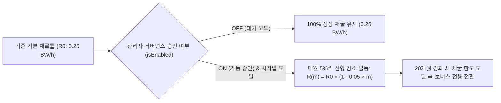

# 📘 [BitWish Network] 반감기 거버넌스 관리 시스템 운영 및 사용 표준 지침서

> **문서 번호**: BW-SOP-HALVING-20261124-A  
> **발행 일자**: 2026-11-24  
> **대상 시스템**: `BitWishNetwork_MiningSystem` (관리자 웹 콘솔 & 백엔드 코어 엔진)  
> **문서 목적**: 비개발자 관리자 및 최고 운영 책임자가 비트위시 네트워크의 선형 반감기 엔진을 안전하고 오차 없이 직접 통제·운영하기 위한 표준 운영 절차서(SOP)  
> **적용 백서**: BitWish Network 백서 v1.0 §1.4 선형 반감기 정책 규격  

---

## 📑 목차 (Table of Contents)

1. [개요 및 반감기 시스템의 핵심 원리](#1-개요-및-반감기-시스템의-핵심-원리)
2. [관리자 페이지 접속 및 전체 레이아웃 조망](#2-관리자-페이지-접속-및-전체-레이아웃-조망)
3. [구역 1: 상단 3대 핵심 상태 모니터링 카드](#3-구역-1-상단-3대-핵심-상태-모니터링-카드)
4. [구역 2: 반감기 정책 설정 및 거버넌스 제어 패널](#4-구역-2-반감기-정책-설정-및-거버넌스-제어-패널)
5. [구역 3: 24개월 실시간 스케줄 시뮬레이터 표 해석법](#5-구역-3-24개월-실시간-스케줄-시뮬레이터-표-해석법)
6. [상황별 실무 운영 표준 절차 (SOP)](#6-상황별-실무-운영-표준-절차-sop)
7. [보안 안전 수칙 및 데이터 영구 보존 원리](#7-보안-안전-수칙-및-데이터-영구-보존-원리)

---

## 1. 개요 및 반감기 시스템의 핵심 원리

비트위시 네트워크(BitWish Network)의 총 공급량은 **21,000,000,000 BW (210억 개)**로 영구히 고정되어 있습니다. 이 중 65%에 달하는 마이닝 풀(136.5억 개)의 건전한 인플레이션 방어와 자산 가치 보존을 위해 백서 §1.4에 따라 **"선형 반감기(Linear Halving)"** 시스템이 도입되었습니다.



### 🛡️ 비트위시 반감기만의 2대 철통 안전 원칙
1. **무단 발동 0% 원천 차단 (관리자 승인 필수)**:
   * 날짜가 2028년이 되든 언제가 되든, 관리자가 관리자 페이지에서 직접 **`ON (가동 승인)`** 버튼을 누르고 저장하지 않는 한, 시스템은 영원히 **기본 채굴률 100%(0.25 BW/h)**를 안전하게 유지합니다.
   * 이는 폐쇄형 베타 테스트 및 메인넷 런칭 이전 단계에서 뜻하지 않은 채굴량 감소가 일어나는 것을 완벽하게 방어합니다.
2. **50자리 초정밀 무오차 연산 (`Decimal.js`)**:
   * 소수점 연산 오차가 누적되어 자산 수치가 왜곡되는 구형 블록체인의 한계를 극복하고, 소수점 50자리 끝자리까지 엄격한 수학적 공식으로 채굴량이 통제됩니다.

---

## 2. 관리자 페이지 접속 및 전체 레이아웃 조망

### 🧭 접속 경로
1. 관리자 웹 브라우저 접속: `http://localhost:5000` (운영 환경: `https://bitwishnetwork.com`)
2. 상단 네비게이션 바에서 **[관리자 페이지]** 메뉴 클릭
3. 관리자 사이드바 또는 상단 서브 탭에서 **`[⏰ 반감기 정책 관리]`** 탭 클릭

### 🖥️ 화면 3대 핵심 구역 구성
```
┌─────────────────────────────────────────────────────────────────────────────┐
│ ⏰ 반감기 정책 거버넌스 관리 콘솔                                [상태 새로고침] │
├─────────────────────────────────────────────────────────────────────────────┤
│ [구역 1] 상단 3대 핵심 모니터링 바                                            │
│  ┌──────────────────────┬──────────────────────┬──────────────────────────┐ │
│  │ 카드 1: 가동 모드 배지 │ 카드 2: D-Day 타이머 │ 카드 3: 현재 적용 채굴률  │ │
│  └──────────────────────┴──────────────────────┴──────────────────────────┘ │
├─────────────────────────────────────────────────────────────────────────────┤
│ [구역 2] 반감기 정책 설정 및 거버넌스 제어 패널                               │
│  - 스위치: [ON (가동 승인)] vs [OFF (대기 모드)]                            │
│  - 시작일시: 달력/시간 선택기 + 빠른 프리셋 4종                              │
│  - 월별 채굴 감소율: 5.0%/월 (슬라이더 및 퀵 버튼)                           │
│  - [💾 반감기 정책 설정 영구 저장]   [⚡ 전체 마이너 채굴률 즉시 일괄 동기화]      │
├─────────────────────────────────────────────────────────────────────────────┤
│ [구역 3] 선형 반감기 24개월 실시간 스케줄 시뮬레이션 표                      │
│  - 시작 연월부터 24개월간의 시간당 채굴량 및 일일 최대 공급량 실시간 렌더링     │
└─────────────────────────────────────────────────────────────────────────────┘
```

---

## 3. 구역 1: 상단 3대 핵심 상태 모니터링 카드

현재 네트워크 전체의 반감기 작동 상태를 한눈에 파악할 수 있는 실시간 대시보드입니다.

### ① 카드 1: 반감기 엔진 가동 모드
* **녹색 배지 `🟢 가동 승인 (ACTIVE)`**:
  * 관리자가 반감기 가동을 공식 승인한 상태입니다.
  * 지정된 시작 일시에 도달하면 백서 공식에 따라 자동으로 채굴량 감산이 시작됩니다.
* **주황색 배지 `🟠 대기·준비중 (STANDBY / OFF)`**:
  * 관리자 안전 가드가 작동 중인 상태입니다.
  * 시작 일시가 도래하더라도 채굴량이 절대 줄어들지 않고 기본 0.25 BW/h가 100% 안전하게 유지됩니다.

### ② 카드 2: 반감기 개시 카운트다운 (실시간)
* **`OFF (대기 모드)`일 때**:
  * 타이머가 스스로 멈추며 **`⏸️ 대기 모드 (가동 승인 대기 중)`** 텍스트가 표시됩니다.
  * 하단 안내: `"🛡️ 관리자 안전 가드가 작동 중이며, 카운트다운이 정지되어 있습니다."`
* **`ON (가동 승인)`일 때**:
  * 타이머가 기상하여 **`D-403일 01시간 32분 40초`** 형태로 1초마다 초(`ss`) 단위가 째깍째깍 살아서 움직입니다.
  * 하단 안내: `"🚀 반감기 공식이 승인되었으며, 시작일 도달 시 자동 감산됩니다."`

### ③ 카드 3: 현재 네트워크 기본 채굴률
* **표시 값**: 현재 모든 일반 유저에게 적용되고 있는 실시간 기본 채굴률 (예: `0.25000000 BW/h`).
* **일일 기본 최대**: 하루 24시간 동안 기본 채굴기로 생산할 수 있는 최대 BW 포인트 (예: `6.000000 BW / 24h`).
* 반감기가 발동하여 감산이 시작되면, 이 카드의 수치가 0.23750000 BW/h, 0.22500000 BW/h 등으로 자동 하향 조정됩니다.

---

## 4. 구역 2: 반감기 정책 설정 및 거버넌스 제어 패널

관리자가 마우스 클릭과 간단한 수치 입력만으로 네트워크 정책을 자유자재로 지휘하는 핵심 조종석입니다.

### 🎛️ 1. 반감기 가동 스위치 (ON / OFF)
* **`ON (가동 승인)`**: 반감기 엔진 활성화. 시작일시가 되면 감산이 집행됩니다.
* **`OFF (대기 모드)`**: 반감기 엔진 동결. 시작일시가 되어도 기본 채굴량 100%가 유지됩니다.

### 📅 2. 반감기 시작 일시 및 [빠른 프리셋 4종]
관리자가 날짜를 변경하는 순간 상단의 D-Day 카운트다운과 하단의 24개월 표가 즉시 늘어나고 줄어듭니다.
* **`datetime-local` 입력기**: 연/월/일/시/분을 자유롭게 직접 선택.
* **원클릭 빠른 프리셋 4종**:
  1. **`🎯 백서 2028년`**: 백서 공식 기본값(`2028-01-01 00:00:00 KST`)으로 즉시 원복.
  2. **`⚡ 내일 (테스트)`**: 시작일을 내일로 앞당겨 D-Day가 `D-0일...`로 급감하는 임박 테스트.
  3. **`🗓️ 30일 뒤`**: 한 달 뒤로 설정하여 단기 거버넌스 테스트.
  4. **`🔭 2029년 (미루기)`**: 2029년으로 1년 미루어 D-Day가 쑥 늘어나는 장기 연기 테스트.

### 📉 3. 월별 채굴 감소율 (%)
* **슬라이더 및 입력 범위**: 최소 0.5% ~ 최대 20.0%까지 자유롭게 미세 조정 가능.
* **빠른 선택 퀵 버튼**: `1.0%`, `3.0%`, `5.0%(백서 정규)`, `10.0%`.

### 🪙 4. 기본 채굴률 기준값 ($R_0$)
* 백서 기준값은 **`0.25 BW/h`**이며, 네트워크 정책에 따라 기본 속도를 변경할 때 사용합니다.

---

### 💾 [핵심 버튼 1] `[반감기 정책 설정 영구 저장]`의 역할
* **무슨 일을 하는가?**:
  * 관리자가 화면에서 변경한 ON/OFF 스위치, 시작일시, 감소율 수치를 **MongoDB의 `systemconfigs` 1급 보존 원장에 즉시 영구 기록**합니다.
* **새로고침(F5) 유지 보장**:
  * 웹 화면의 임시 상태가 아니라 데이터베이스에 단단히 저장되므로, **브라우저를 새로고침(F5)하거나 컴퓨터를 껐다 켜도 관리자가 승인한 `ON` 상태와 변경된 날짜가 100% 그대로 유지**됩니다.
* **성공 확인**:
  * 클릭 시 상단에 **`✅ 반감기 정책이 MongoDB에 안전하게 영구 저장되었습니다! (새로고침 시에도 유지됨)`** 초록색 배지가 뜹니다.

---

### ⚡ [핵심 버튼 2] `[전체 마이너 채굴률 즉시 일괄 동기화]`의 역할
* **무슨 일을 하는가?**:
  * 현재 채굴기를 켜두고 실시간 채굴 중인 **전 세계 모든 마이너들의 DB 장부(`MiningState`)를 1초 만에 전수 검사하여 최신 반감기 정책으로 강제 일괄 동기화**합니다.
* **언제 누르는가?**:
  * 관리자가 정책(시작일이나 감소율)을 변경하여 저장한 후, 현재 채굴 중인 마이너들에게 새 채굴 속도를 즉각 전파하고자 할 때 클릭합니다.
* **성공 확인**:
  * 클릭 시 확인 팝업 후 **`⚡ 채굴 중인 전체 마이너 N명에게 최신 기본 채굴률(...)이 성공적으로 동기화되었습니다.`** 알림이 표시됩니다.

---

## 5. 구역 3: 24개월 실시간 스케줄 시뮬레이터 표 해석법

관리자가 시작일이나 퍼센트를 건드리는 순간, 0.001초 만에 브라우저에서 계산되어 아래의 24단계 표가 촤르륵 펼쳐집니다.

$$R(m) = R_0 \times (1 - 0.05 \times m) \quad (\text{단, } R(m) \ge 0)$$

| 단계 (m) | 적용 연월 | 누적 감소율 | 시간당 기본 채굴률 | 일일 기본 최대 (24h) | 정책 상태 설명 |
| :---: | :---: | :---: | :---: | :---: | :---|
| **시작** | **2028년 01월** | **0.0%** | **0.250000 BW/h** | **6.000000 BW** | 🚀 **반감기 공식 개시 (100% 정상 공급)** |
| **1개월** | 2028년 02월 | 5.0% | 0.237500 BW/h | 5.700000 BW | 📉 1차 선형 감산 (-5.0%) |
| **2개월** | 2028년 03월 | 10.0% | 0.225000 BW/h | 5.400000 BW | 📉 2차 선형 감산 (-10.0%) |
| **...** | ... | ... | ... | ... | ... |
| **10개월** | 2028년 11월 | 50.0% | 0.125000 BW/h | 3.000000 BW | 📉 10차 선형 감산 (-50.0%) |
| **19개월** | 2029년 08월 | 95.0% | 0.012500 BW/h | 0.300000 BW | 📉 19차 선형 감산 (-95.0%) |
| **20개월** | **2029년 09월** | **100.0%** | **0.000000 BW/h** | **0.000000 BW** | 🛑 **채굴 한도 도달 (보너스 전용 전환)** |

> [!NOTE]
> **채굴 한도 도달(20개월 차)의 의미**:
> 기본 채굴률이 0이 되더라도 유저의 기존 잔액이 사라지는 것이 아니며, 이후에는 친구 초대 2% 보너스나 출석 5% 보너스 등 생태계 기여 보상만으로 채굴이 이어지도록 백서 설계가 완벽히 구현되어 있습니다.

---

## 6. 상황별 실무 운영 표준 절차 (SOP)

### 📌 케이스 A: 폐쇄형 베타 테스트 중 반감기 작동을 직접 테스트해보고 싶을 때
1. 관리자 콘솔의 제어 패널에서 **`ON (가동 승인)`** 버튼을 클릭합니다.
2. 빠른 프리셋 중 **`[⚡ 내일 (테스트)]`** 버튼을 클릭합니다.
   * 상단 D-Day 카운트다운이 즉시 `D-0일 XX시간 XX분 XX초`로 째깍째깍 도는 것을 확인합니다.
3. 파란색 **`[💾 반감기 정책 설정 저장]`** 버튼을 클릭합니다.
4. 브라우저에서 **`F5 (새로고침)`**을 눌러 설정이 그대로 유지되는지 확인합니다.
5. 테스트가 끝나면 다시 **`OFF (대기 모드)`**를 누르고 `[설정 저장]`을 눌러 대기 상태로 안전 복귀시킵니다.

### 📌 케이스 B: 메인넷 오픈 일정 변경으로 반감기를 2029년으로 미루고자 할 때
1. 제어 패널에서 빠른 프리셋 중 **`[🔭 2029년 (미루기)]`** 버튼을 클릭합니다. (또는 달력에서 원하는 날짜 선택)
2. 하단 24개월 표의 시작 연월이 `2029년 01월`로 갱신되었는지 확인합니다.
3. 파란색 **`[💾 반감기 정책 설정 저장]`** 버튼을 클릭하여 DB에 영구 반영합니다.

### 📌 케이스 C: 비상 상황으로 반감기 감산을 즉시 멈추고 100% 채굴로 되돌릴 때
1. 스위치에서 **`OFF (대기 모드)`** 버튼을 클릭합니다.
2. 상단 카운트다운이 **`⏸️ 대기 모드 (가동 승인 대기 중)`**으로 멈추는지 확인합니다.
3. 파란색 **`[💾 반감기 정책 설정 저장]`** 버튼을 클릭합니다.
4. 초록색 **`[⚡ 전체 마이너 채굴률 즉시 일괄 동기화]`** 버튼을 클릭하여 모든 유저의 채굴 속도를 즉시 0.25 BW/h로 원상 복구시킵니다.

---

## 7. 보안 안전 수칙 및 데이터 영구 보존 원리

1. **MongoDB `systemconfigs` 1급 불멸 보존 원칙**:
   * MongoDB 표준 초기화 지침서에 따라, 테스트 진행 중 유저 지갑(`users`)이나 채굴량(`miningstates`), 블록(`blocks`)을 비우더라도, 관리자 정책이 담긴 `systemconfigs` 컬렉션은 **절대 삭제되지 않는 1급 보존 구역**으로 지정되어 있습니다.
   * 따라서 DB 초기화 작업을 수백 번 진행해도 관리자가 설정한 반감기 정책은 결코 날아가지 않습니다.
2. **5초 스마트 캐시 완충 보호 (`Cache TTL`)**:
   * 수천 명의 유저가 1초마다 채굴 동기화 요청을 보내도 DB에 과부하가 걸리지 않도록, 백엔드 엔진은 관리자 정책을 5초간 메모리 캐시로 초고속 처리합니다.
   * 관리자가 설정을 변경하고 저장하는 순간에는 `invalidateCache()`가 즉시 호출되어 시차 없이 전파됩니다.

---

**문서 승인자**: BitWish Network 코어 거버넌스 아키텍트 팀  
**보관 위치**: `c:\BitWishNetwork_BlockChainMainnet\BitWishNetwork_Project_Reports\2026-11월작업 계획서 및 완료 보고서 보관함\24일 작업 일지 및 작업 계획서 & 완료 보고서 보관함\20261124_반감기_거버넌스_관리_시스템_운영_및_사용_표준_지침서.md`