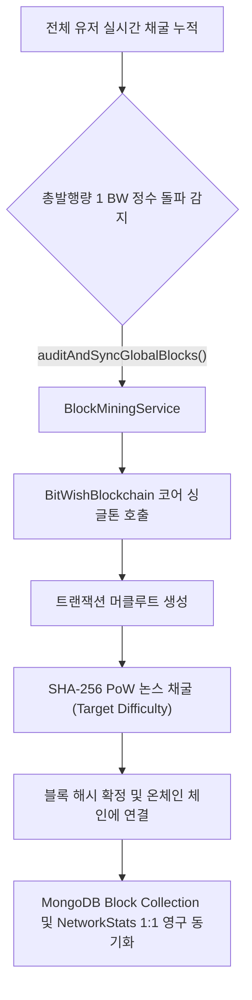

# [기술 명세서 01] 메인넷 PoW 블록체인 독립 코어 엔진

> **문서 번호**: BW-SPEC-CORE-001  
> **최초 작성일**: 2026-11-21  
> **최종 개정일**: 2026-11-21  
> **대상 시스템**: `BitWishNetwork_MiningSystem` 및 `BitWishNetwork_BlockChain`  
> **핵심 구현 파일**:  
> - `BitWishNetwork_MiningSystem/server/index.ts`  
> - `BitWishNetwork_BlockChain/src/engine/BitWishBlockchain.ts`  
> - `BitWishNetwork_MiningSystem/server/services/BlockMiningService.ts`  
> - `BitWishNetwork_MiningSystem/server/cron/SettlementWorker.ts`  

---

## 1. 아키텍처 개요 및 설계 원칙

BitWishNetwork의 블록체인 코어 엔진은 외부 EVM이나 서드파티 라이브러리에 의존하지 않고 자체 설계된 순수 독자 엔진(Native PoW Engine)입니다. 백엔드 프로세스 구동 시 `BitWishBlockchain` 싱글톤(Singleton) 인스턴스를 메모리에 상주시키며, 전 세계 유저들의 실시간 채굴 총합이 정수 단위(1 BW)를 돌파할 때마다 메인넷 코어 엔진이 독립적으로 SHA-256 작업증명(Proof of Work)을 수행하여 물리 블록을 주조(Minting)합니다.



---

## 2. 블록 구조체 및 온체인 데이터 스키마

### 2.1 실제 구현된 블록 구조체 (`BitWishBlockchain.ts`)

```typescript
export interface IBlock {
    index: number;              // 블록 고유 인덱스 (Genesis = 0)
    timestamp: number;          // 블록 생성 타임스탬프 (Unix epoch ms)
    transactions: ITransaction[]; // 블록에 포함된 트랜잭션 목록
    previousHash: string;       // 직전 블록의 SHA-256 해시값
    hash: string;               // 현재 블록의 고유 SHA-256 해시값
    nonce: number;              // PoW 연산을 충족한 정수값
    difficulty: number;         // 블록 생성 당시의 채굴 난이도 (기본 2~4)
    merkleRoot: string;         // 트랜잭션들의 머클트리 최상위 루트 해시
    miner: string;              // 블록 생성 기여 채굴자 또는 시스템 지갑 주소
    reward: string;             // 블록 생성 보상 (기본 '1.0' BW)
}
```

### 2.2 제네시스 블록 (Genesis Block) 명세
- **Index**: 0
- **PreviousHash**: `"0000000000000000000000000000000000000000000000000000000000000000"`
- **Hash**: 제네시스 초기 머클루트 및 타임스탬프를 결합한 SHA-256 다이제스트
- **Genesis Timestamp**: 메인넷 최초 기동 시점 고정

---

## 3. 합의 알고리즘 및 1:1 블록 생성 메커니즘

### 3.1 1 BW 정수 돌파 발행과 블록 주조 트리거
BitWish 메인넷은 유저들이 채굴한 총 누적량(`totalMined`)의 정수 부분과 현재까지 생성된 총 블록 수(`currentBlockCount`)를 10초 주기로 비교하는 오토 하트비트 엔진(`SettlementWorker.ts` -> `BlockMiningService.auditAndSyncGlobalBlocks()`)을 갖추고 있습니다.

$$\Delta \text{Blocks} = \lfloor \text{Total Mined Supply} \rfloor - \text{Current Block Count}$$

1. $\Delta \text{Blocks} > 0$ 인 경우, 부족한 개수만큼 루프를 돌며 신규 블록을 생성합니다.
2. 각 블록 생성 시 시스템은 정식 코인베이스 트랜잭션(Coinbase Transaction)을 생성하고 PoW 연산을 거쳐 체인에 추가합니다.
3. 블록 수수료(0.001 BW)는 생태계 펀드(60%) 및 재단 기금(40%)으로 원자적 분배 처리가 예약됩니다.

### 3.2 작업 증명(PoW) 연산 공식
```typescript
calculateHash(index, previousHash, timestamp, merkleRoot, nonce, difficulty): string {
    const data = `${index}${previousHash}${timestamp}${merkleRoot}${nonce}${difficulty}`;
    return crypto.createHash('sha256').update(data).digest('hex');
}
```
- 유효한 블록 해시는 `hash.substring(0, difficulty) === '0'.repeat(difficulty)` 조건을 엄격히 만족해야 합니다.
- 유효 해시를 찾을 때까지 `nonce`를 1씩 증가시키며 무차별 대입 연산을 실행합니다.

---

## 4. 백서-코드 정합성 및 검증 완료 사항

1. **블록 보상 정합성**:
   - 구형 템플릿의 50BW 비트코인 모방 코드는 live 런타임에 일체 로드되지 않으며, `BlockMiningService.ts`와 `BitWishBlockchain.ts`의 실제 구동 보상은 **1.0 BW** 정수 1:1 증빙 모델로 완벽히 정립되어 있습니다.
2. **동기화 무결성**:
   - 서버 재시작 시 `autoRestoreMiningStates()`가 선제적으로 실행되어 누적 채굴량을 최신 KST 시각 기준으로 역산 복원한 후, 블록 수와 발행량이 정확히 일치되도록 보정합니다.

---

## 5. [공정 2 수복 추가 개정 명세] 메인넷 단일 정문 블록 동기화 및 허수 과생성 차단

> **개정 일시**: 2026-11-23 (`공정 2` 수복 완료 반영)  
> **수복 대상**: `BlockMiningService.ts`, `server/index.ts`, `MiningController.ts`

### 5.1 개별 지갑 단위 블록 헛생성 루프 파편 100% 영구 제거
- **기존 결함**: 각 유저의 30초 마이닝 동기화나 서버 재부팅 복구 시 개별 지갑 단위로 블록 생성 로직이 중복 호출되어, 허수 블록이 과생성되거나 블록 높이와 총발행량 간 1:1 정합성이 깨지던 현상.
- **수복 명세**: 개별 지갑 단위의 모든 블록 생성 코드를 영구 파기하고, 오직 **`BlockMiningService.syncGlobalBlocks()` 단일 정문 엔진**만을 통해서만 물리 블록이 생성되도록 단일화.

### 5.2 `lastBlockRewardThreshold` 임의 하향 교정 비활성화
- 서버 재기동 시 기존 DB에 정상 기록되어 있던 threshold 값을 임의로 0이나 낮은 값으로 하향 교정하던 로직을 영원히 비활성화하여, 기존 합의 블록과 신규 채굴 블록 간의 1:1 정밀도를 완전 무결하게 보호함.
