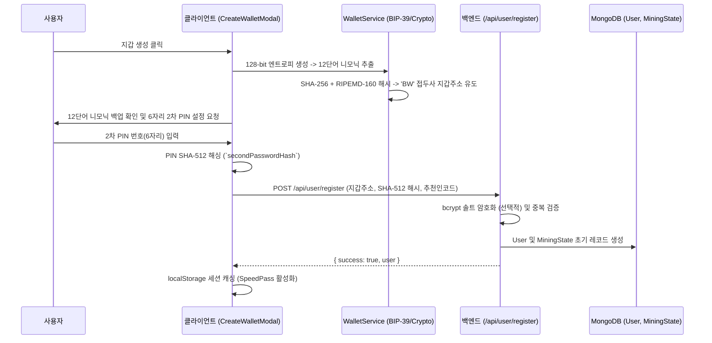

# [기술 명세서 02] 지갑 생성, 보안 인증 및 SpeedPass 세션

> **문서 번호**: BW-SPEC-AUTH-002  
> **최초 작성일**: 2026-11-21  
> **최종 개정일**: 2026-11-21  
> **대상 시스템**: `BitWishNetwork_MiningSystem`  
> **핵심 구현 파일**:  
> - `server/controllers/UserController.ts`  
> - `server/routes/user.ts`  
> - `server/models/User.ts`  
> - `src/components/CreateWalletModal/CreateWalletModal.tsx`  
> - `src/components/WalletAuthModal/WalletAuthModal.tsx`  
> - `src/components/MiningAuthModal/MiningAuthModal.tsx`  
> - `src/services/BlockchainService/WalletService.ts`  

---

## 1. 지갑 생성 아키텍처 및 BIP-39 니모닉 체계

BitWish 지갑은 클라이언트 사이드에서 BIP-39 표준 12단어 영문 니모닉(Mnemonic)을 무작위 생성하는 비수탁(Non-Custodial) 방식의 주소 유도 파이프라인을 가집니다.



---

## 2. 2차 비밀번호 및 보안 검증 체계

### 2.1 6자리 보안 PIN (SHA-512 지문)
- 유저는 지갑 생성 또는 자산 이체 시 6자리 숫자로 구성된 2차 비밀번호를 사용합니다.
- 클라이언트는 평문 PIN을 네트워크로 직접 전송하지 않고, 클라이언트 단에서 1차로 SHA-512 해싱을 수행합니다:
  ```typescript
  const pinHash = crypto.createHash('sha512').update(pinCode).digest('hex');
  ```
- 백엔드 `UserController.ts`는 수신된 해시값을 검증하거나, 복합 인증 파이프라인을 통해 저장된 해시와 대조합니다.

### 2.2 Google OTP (2FA) 스키마
- `User.ts` 스키마 내에 `isOTPEnabled: { type: Boolean, default: false }` 및 `otpSecret` 필드가 정의되어 있어, 추후 2FA 확장을 지원하는 유연한 설계를 갖추고 있습니다.

---

## 3. SpeedPass 원터치 세션 엔진

### 3.1 작동 메커니즘
- 사용자가 동일 브라우저에서 지갑을 1회 생성하거나 정상 인증에 성공하면, `localStorage`에 암호화된 세션 토큰 및 지갑 주소가 안전하게 적립됩니다.
- 홈페이지 진입 시 `HomePage.tsx`와 `MiningAuthModal.tsx`는 SpeedPass 캐시를 자동 감지합니다:
  1. 캐시된 주소 존재 시: PIN 재입력 없이 즉시 채굴 대시보드 및 지갑 위젯 활성화
  2. 캐시 만료 또는 미존재 시: 6자리 PIN 입력 모달(`WalletAuthModal`) 또는 니모닉 복구 모달 호출
- 브라우저 스토리지 청소 또는 수동 로그아웃 시 SpeedPass 세션은 안전하게 파기됩니다.
