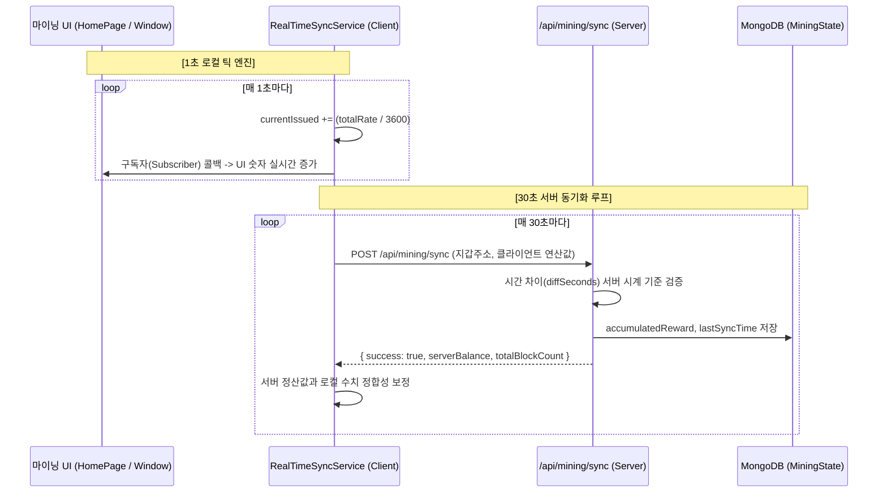

# [기술 명세서 03] 실시간 틱 채굴 및 다중 부스트 엔진

> **문서 번호**: BW-SPEC-MINING-003  
> **최초 작성일**: 2026-11-21  
> **최종 개정일**: 2026-11-21  
> **대상 시스템**: `BitWishNetwork_MiningSystem`  
> **핵심 구현 파일**:  
> - `server/controllers/MiningController.ts`  
> - `server/models/MiningState.ts`  
> - `src/services/MiningService/RealTimeSyncService.ts`  
> - `src/utils/PrecisionCalculator/PrecisionCalculator.ts`  
> - `src/components/MiningSystemWindow/MiningSystemWindow.tsx`  

---

## 1. 채굴 수학 공식 및 다중 부스트 체계

### 1.1 기본 채굴률 (Base Rate)
- **시간당 기본 채굴률 ($R_{\text{base}}$)**: $0.25 \text{ BW/h}$
- **초당 기본 채굴률 ($r_{\text{sec}}$)**:
  $$r_{\text{sec}} = \frac{0.25}{3600} \approx 0.00006944444444444444... \text{ BW/sec}$$

### 1.2 다중 부스트 결합 공식
채굴 속도는 유저의 활동에 따라 3가지 부스트가 중첩 적용됩니다:
1. **출석 체크 부스트 ($B_{\text{att}}$)**: $+5\% = 0.05$ (24시간/오전 9시 만료 유효)
2. **크롬 확장프로그램 부스트 ($B_{\text{ext}}$)**: $+30\% = 0.30$ (활성 설치 연동 시)
3. **추천인 초대 부스트 ($B_{\text{ref}}$)**: 활성 피추천인 1인당 $+2\% = 0.02 \times N$

$$\text{Total Rate (BW/h)} = R_{\text{base}} \times \left( 1 + B_{\text{att}} + B_{\text{ext}} + \sum_{i=1}^{N} B_{\text{ref}, i} \right)$$

---

## 2. 1초 클라이언트 틱과 30초 서버 동기화 파이프라인

---

## 3. 오프라인 채굴 복원 및 부동소수점 정밀도 거버넌스

### 3.1 오프라인 누적 역산 알고리즘
유저가 브라우저를 닫거나 컴퓨터를 꺼도 채굴은 백엔드에서 멈추지 않습니다. 유저가 다시 접속하거나 서버가 재시작되면:
$$\Delta t = \text{now} - \text{lastSyncTime} \quad (\text{단위: 초})$$
$$\Delta \text{Reward} = \left(\frac{\text{currentTotalRate}}{3600}\right) \times \Delta t$$
$$\text{accumulatedReward}_{\text{new}} = \text{accumulatedReward}_{\text{prev}} + \Delta \text{Reward}$$
이를 통해 서버-클라이언트 간 오차 0의 완벽한 연속 채굴을 보장합니다.

### 3.2 부동소수점 정밀도 결함 진단 및 개선안
- **현행 코드 결함**: `RealTimeSyncService.ts`에서 연산 도중 `next.toNumber()`를 호출하여 IEEE 754 float로 다운캐스팅되는 정밀도 유실 발생.
- **수복 표준**: Decimal.js 인스턴스를 유지하거나 string 직렬화(`toFixed(50)`)를 통해 50자리 초정밀 연산을 온전히 보존하도록 수복 규정.
