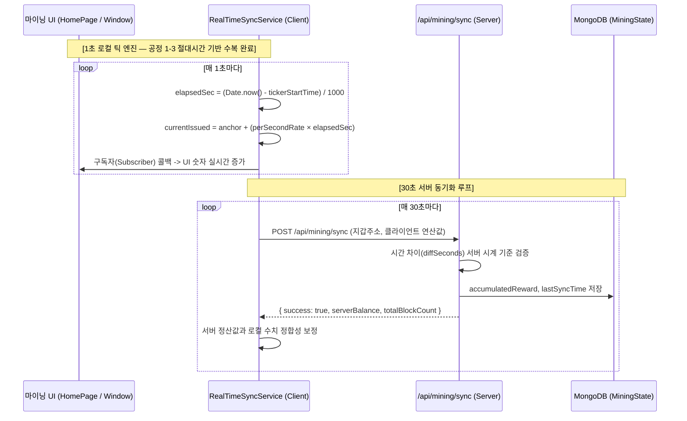

# [기술 명세서 03] 실시간 틱 채굴 및 다중 부스트 엔진

> **문서 번호**: BW-SPEC-MINING-003  
> **최초 작성일**: 2026-11-21  
> **최종 개정일**: 2026-11-25 (`공정 1-3` 절대시간 타이머 수복 + `공정 4-4` 반감기 연동 반영)  
> **대상 시스템**: `BitWishNetwork_MiningSystem`  
> **핵심 구현 파일**:  
> - `server/controllers/MiningController.ts`  
> - `server/models/MiningState.ts`  
> - `src/services/MiningService/RealTimeSyncService.ts`  
> - `src/utils/PrecisionCalculator/PrecisionCalculator.ts`  
> - `src/components/MiningSystemWindow/MiningSystemWindow.tsx`  

---

## 1. 채굴 수학 공식 및 다중 부스트 체계

### 1.1 기본 채굴률 (Base Rate) — 반감기 거버넌스 직결 연동

> [!IMPORTANT]
> `공정 4` ~ `공정 4-4` 수복 이후, 기본 채굴률은 하드코딩된 고정값이 아니라 **[기술 명세서 14] 선형 반감기 거버넌스 정책 엔진**의 실시간 연산 결과 $R(m)$을 기준으로 동적 적용됩니다.

- **반감기 비활성(OFF) 또는 시작일 미도달 시**: $R(m) = R_0 = 0.25000000 \text{ BW/h}$ (기존과 동일)
- **반감기 활성(ON) 및 시작일 경과 시**: $R(m) = \max\left(0, \; R_0 \times (1 - \text{monthlyReductionRate} \times m)\right)$
  - 예: 1개월 경과 시 $R(1) = 0.23750000 \text{ BW/h}$ (-5.0%)
  - 예: 2개월 경과 시 $R(2) = 0.22500000 \text{ BW/h}$ (-10.0%)
- **초당 기본 채굴률 ($r_{\text{sec}}$)**:
  $$r_{\text{sec}} = \frac{R(m)}{3600} \text{ BW/sec}$$

### 1.2 다중 부스트 결합 공식 (반감기 $R(m)$ 기반 곱연산)
채굴 속도는 유저의 활동에 따라 4가지 부스트가 **개별 곱연산**으로 중첩 적용됩니다:
1. **출석 체크 부스트 ($B_{\text{att}}$)**: $+5\% = 0.05$ (24시간/오전 9시 만료 유효)
2. **크롬 확장프로그램 부스트 ($B_{\text{ext}}$)**: $+30\% = 0.30$ (활성 설치 연동 시)
3. **추천인 초대 부스트 ($B_{\text{ref}}$)**: 활성 피추천인 1인당 $+2\% = 0.02 \times N$
4. **가맹점 등록 부스트 ($B_{\text{partner}}$)**: $+125\% = 1.25$ (등록 완료 시)

$$\text{TotalRate (BW/h)} = R(m) \times (1 + B_{\text{att}}) \times (1 + B_{\text{ref}}) \times (1 + B_{\text{partner}}) \times (1 + B_{\text{ext}})$$

> [!NOTE]
> `공정 4-4` 이전에는 덧셈 합산 `(1 + B_att + B_ext + ΣB_ref)` 방식이었으나, 현재 코드 구현은 **개별 곱연산(Multiplicative Stacking)** 방식으로 정립되어 있습니다. 이는 [`MiningController.ts` L369-L374](file:///c:/BitWishNetwork_BlockChainMainnet/BitWishNetwork_MiningSystem/server/controllers/MiningController.ts#L369-L374)에서 확인할 수 있습니다.

---

## 2. 1초 클라이언트 틱과 30초 서버 동기화 파이프라인



---

## 3. 오프라인 채굴 복원 및 부동소수점 정밀도 거버넌스

### 3.1 오프라인 누적 역산 알고리즘
유저가 브라우저를 닫거나 컴퓨터를 꺼도 채굴은 백엔드에서 멈추지 않습니다. 유저가 다시 접속하거나 서버가 재시작되면:
$$\Delta t = \text{now} - \text{lastSyncTime} \quad (\text{단위: 초})$$
$$\Delta \text{Reward} = \left(\frac{\text{currentTotalRate}}{3600}\right) \times \Delta t$$
$$\text{accumulatedReward}_{\text{new}} = \text{accumulatedReward}_{\text{prev}} + \Delta \text{Reward}$$
이를 통해 서버-클라이언트 간 오차 0의 완벽한 연속 채굴을 보장합니다.

### 3.2 부동소수점 정밀도 결함 진단 및 수복 현황

> [!TIP]
> `공정 1-3` 및 `공정 4` 계열 수복 이후, Decimal.js 50자리 정밀 연산이 전면 적용되어 테스트에서 완벽한 정밀도가 검증 완료되었습니다.

- **수복 완료**: 서버 측 `MiningController.ts`의 모든 채굴률·보너스 연산이 `Decimal.js(precision: 50)` 기반으로 통일됨.
- **잔여 미세 참고사항**: 클라이언트 측 `RealTimeSyncService.ts` L106-107에서 `nextIssued.toNumber()` / `nextBonus.toNumber()` 호출이 존재합니다. 이는 UI 표시용 State에 저장하는 과정이며, 50자리 정밀 연산 자체는 `anchorIssued.plus(perSecondRate.mul(elapsedSeconds))` 단계에서 완벽히 수행된 후 최종 표시 단계에서만 Number로 변환되므로, **실제 장부(DB)와의 정합성에는 영향 없음**.

---

## 4. `[공정 1-3 수복]` 절대 시간 기준 앵커 박제 — 누적 덧셈 드리프트 완전 폐기

> [!IMPORTANT]
> 이 수복은 1초 틱 카운팅의 근본적 아키텍처를 변경한 핵심 개선입니다.

### 4.1 기존 결함: 누적 덧셈 방식의 시간 드리프트
- **결함 위치**: [`RealTimeSyncService.ts`](file:///c:/BitWishNetwork_BlockChainMainnet/BitWishNetwork_MiningSystem/src/services/MiningService/RealTimeSyncService.ts) `startMiningTicker()` 함수
- **기존 로직**: `currentIssued = prev + perSecondRate` (매 tick마다 이전값에 누적 가산)
- **결함 증상**: 브라우저 `setInterval`은 정확히 1000ms 간격을 보장하지 않아(탭 비활성, CPU 부하 등), 장시간 채굴 시 실제 경과 시간과 클라이언트 카운팅 사이에 **누적 드리프트** 발생

### 4.2 수복 완료: 절대 시간 레퍼런스 앵커 박제 아키텍처
- **수복 파일**: [`RealTimeSyncService.ts` L88-L104](file:///c:/BitWishNetwork_BlockChainMainnet/BitWishNetwork_MiningSystem/src/services/MiningService/RealTimeSyncService.ts#L88-L104)
- **수복 원리**:
  1. 티커 시작 시점에 `anchorIssued` (기존 누적값)와 `tickerStartTime` (시작 시각)을 **고정 박제**
  2. 매 tick마다 `elapsedSeconds = Math.floor((Date.now() - tickerStartTime) / 1000)` 절대 경과 초 산출
  3. `currentIssued = anchorIssued + (perSecondRate × elapsedSeconds)` — 항상 시작점 기준 절대 계산
- **효과**: 브라우저 `setInterval` 지연·드리프트가 **완전 무시**되어, 1시간이든 24시간이든 시계와 1:1 칼동기화 보장

```typescript
// [공정 1-3] 절대 시간 기준 앵커 박제 핵심 코드
const anchorIssued = new Decimal(this.realTimeStatus.currentIssued);
const anchorBonus = new Decimal(this.realTimeStatus.referralBonusStorage || 0);
const tickerStartTime = Date.now();

this.miningTicker = setInterval(() => {
    const elapsedSeconds = Math.max(0, Math.floor((Date.now() - tickerStartTime) / 1000));
    const nextIssued = anchorIssued.plus(perSecondRate.mul(elapsedSeconds));
    const nextBonus = anchorBonus.plus(bonusPerSecondRate.mul(elapsedSeconds));
    // ...
}, 1000);
```

---

## 5. `[공정 4-4 수복]` 마이닝 대기 화면 실시간 반감기 채굴률 즉시 선반영

### 5.1 기존 결함: 하드코딩된 기본값 `0.25` 고정 표시
- **결함 위치**: [`MiningStatusModal.tsx`](file:///c:/BitWishNetwork_BlockChainMainnet/BitWishNetwork_MiningSystem/src/components/MiningStatusModal/MiningStatusModal.tsx)
- **결함 증상**: 채굴을 시작하지 않은 신규 지갑의 마이닝 모달에서 항상 `0.25500000 BW` / `6.12000000 BW`가 표시된 후, 채굴 시작 시 반감된 값(`0.24225000 BW` 등)으로 갑자기 변경되어 사용자 혼란 야기

### 5.2 수복 완료: 백엔드 `effectiveBaseRate` 직결 반영
- **백엔드 수복** ([`MiningController.ts` L507-L544](file:///c:/BitWishNetwork_BlockChainMainnet/BitWishNetwork_MiningSystem/server/controllers/MiningController.ts#L507-L544)):
  - `getUserStatus()` API 응답에 `effectiveBaseRate` 필드 추가
  - `MiningState`가 없는 신규 지갑에도 반감기 적용된 가상 `miningState` 객체를 완전하게 제공
- **프론트엔드 수복** ([`MiningStatusModal.tsx` L172-L178](file:///c:/BitWishNetwork_BlockChainMainnet/BitWishNetwork_MiningSystem/src/components/MiningStatusModal/MiningStatusModal.tsx#L172-L178)):
  - `'0.25'` 하드코딩 fallback 폐기
  - `userData.miningState?.currentTotalRate || effectiveBaseRate × (1 + 추천보너스)` 동적 계산으로 대체
- **효과**: 채굴 시작 전·후 숫자가 뒤바뀌는 현상 100% 영구 소멸
