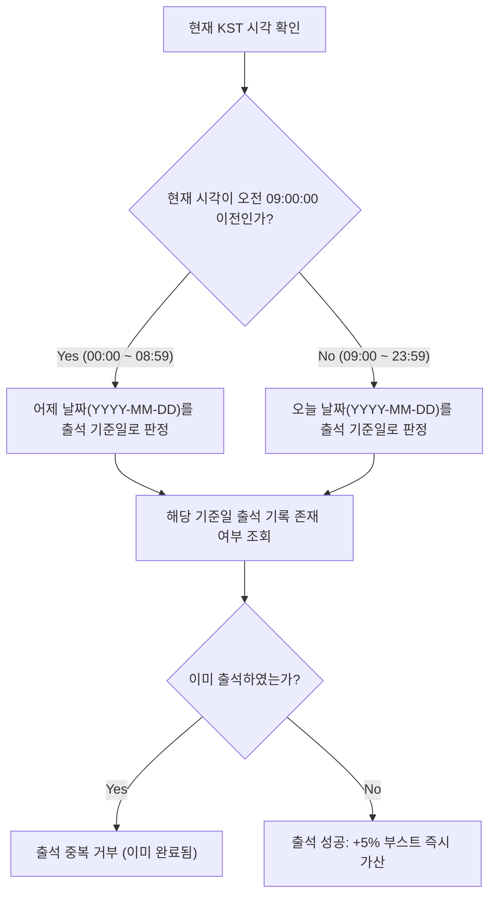

# [기술 명세서 04] 출석 체크 및 오전 9시 만료 라이프사이클

> **문서 번호**: BW-SPEC-ATTEND-004  
> **최초 작성일**: 2026-11-21  
> **최종 개정일**: 2026-11-21  
> **대상 시스템**: `BitWishNetwork_MiningSystem`  
> **핵심 구현 파일**:  
> - `server/routes/attendance.ts`  
> - `server/services/AttendanceBonusService.ts`  
> - `server/controllers/MiningController.ts`  
> - `server/models/MiningState.ts`  
> - `server/models/AttendanceRecord.ts`  

---

## 1. 아키텍처 개요 및 설계 원칙

출석 보너스 시스템은 사용자의 일일 참여를 독려하고 채굴 동기를 극대화하기 위해 매일 1회 출석 체크 시 **+5% (+0.05)** 채굴 속도 부스트를 부여합니다. 전 세계 단일 표준을 위해 **한국 표준시(KST, UTC+9) 매일 오전 09:00:00**를 기준으로 출석 일자가 롤오버(Day-shift)됩니다.

---

## 2. 오전 9시 롤오버 라이프사이클 및 기준일자 역산

### 2.1 KST 오전 9시 기준일 산출 알고리즘
백엔드는 출석 기록의 일자(`recordDate`)를 단순 자정(00:00)이 아닌, 오전 9시를 분기점으로 판정합니다:

```typescript
function getAttendanceDate(now: Date): string {
    const kstNow = new Date(now.getTime() + (9 * 60 * 60 * 1000));
    const hours = kstNow.getUTCHours();
    
    // 오전 9시 이전이면 전날 기록으로 처리 (9시가 새로운 하루의 시작)
    if (hours < 9) {
        kstNow.setUTCDate(kstNow.getUTCDate() - 1);
    }
    return kstNow.toISOString().split('T')[0]; // "YYYY-MM-DD"
}
```



---

## 3. 24시간 만료 순찰 및 채굴 속도 원복 처리

### 3.1 실시간 유효성 검증
`MiningController.ts`에서 유저 상태 조회(`/api/mining/status/:walletAddress`) 또는 채굴 동기화(`/api/mining/sync`)가 호출될 때마다:
1. `MiningState.lastAttendanceTime` 확인
2. 마지막 출석 시각이 유효한 오전 9시 윈도우를 벗어났거나 24시간을 초과한 경우:
   - `attendanceBonusRate`를 즉시 `0`으로 리셋
   - `currentTotalRate`를 재연산하여 DB 및 응답에 반영
3. 출석이 유효한 상태이면 `attendanceBonusRate = '0.05'`를 유지하여 실시간 틱 엔진에 전달

---

## 4. 프론트엔드 연동 및 UI 표기 명세
- 출석 체크 완료 시 UI에 **"+5% 부스트 활성화"** 뱃지가 표시되며, 채굴 게이지에 즉시 반영됩니다.
- 오전 9시 도래 시 프론트엔드 실시간 감지기가 출석 버튼을 다시 활성화하여 당일 출석을 유도합니다.
