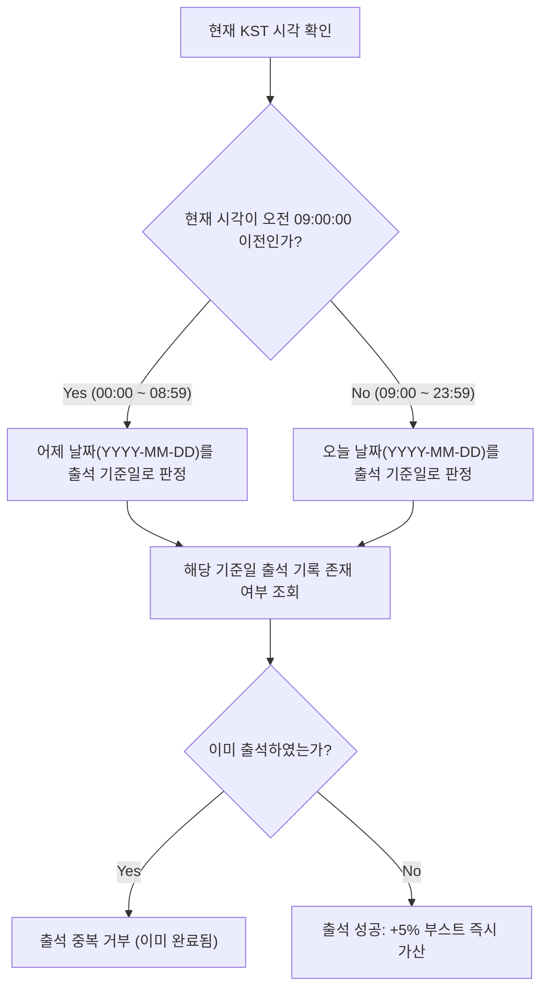

# [기술 명세서 04] 출석 체크 및 오전 9시 만료 라이프사이클

> **문서 번호**: BW-SPEC-ATTEND-004  
> **최초 작성일**: 2026-11-21  
> **최종 개정일**: 2026-11-25 (공정 5 출석 무결성 종합 수복 완료 반영)  
> **대상 시스템**: `BitWishNetwork_MiningSystem`  
> **핵심 구현 파일**:  
> - `server/routes/attendance.ts`  
> - `server/controllers/MiningController.ts`  
> - `src/services/BonusService/AttendanceBonusService.ts`  
> - `src/components/AttendanceModal/AttendanceModal.tsx`  
> - `src/components/MiningStatusModal/MiningStatusModal.tsx`  
> - `server/models/MiningState.ts`  
> - `server/models/BonusRecord.ts`  

---

## 1. 아키텍처 개요 및 설계 원칙

출석 보너스 시스템은 사용자의 일일 참여를 독려하고 채굴 동기를 극대화하기 위해 매일 1회 출석 체크 시 **+5% (+0.05)** 채굴 속도 부스트를 부여합니다. 전 세계 단일 표준을 위해 **한국 표준시(KST, UTC+9) 매일 오전 09:00:00**를 기준으로 출석 일자가 롤오버(Day-shift)됩니다.

---

## 2. 오전 9시 롤오버 라이프사이클 및 기준일자 역산

### 2.1 KST 오전 9시 기준일 산출 알고리즘
백엔드는 출석 기록의 일자(`recordDate`)를 단순 자정(00:00)이 아닌, 오전 9시를 분기점으로 판정합니다:

```typescript
function getAttendanceDate(now: Date): string {
    const kstNow = new Date(now.getTime() + (9 * 60 * 60 * 1000));
    const hours = kstNow.getUTCHours();
    
    // 오전 9시 이전이면 전날 기록으로 처리 (9시가 새로운 하루의 시작)
    if (hours < 9) {
        kstNow.setUTCDate(kstNow.getUTCDate() - 1);
    }
    return kstNow.toISOString().split('T')[0]; // "YYYY-MM-DD"
}
```



---

## 3. 24시간 만료 순찰 및 채굴 속도 원복 처리

### 3.1 실시간 유효성 검증
`MiningController.ts`에서 유저 상태 조회(`/api/mining/status/:walletAddress`) 또는 채굴 동기화(`/api/mining/sync`)가 호출될 때마다:
1. `MiningState.lastAttendanceTime` 확인
2. 마지막 출석 시각이 유효한 오전 9시 윈도우를 벗어났거나 24시간을 초과한 경우:
   - `attendanceBonusRate`를 즉시 `0`으로 리셋
   - `currentTotalRate`를 재연산하여 DB 및 응답에 반영
3. 출석이 유효한 상태이면 `attendanceBonusRate = '0.05'`를 유지하여 실시간 틱 엔진에 전달

---

## 4. 프론트엔드 연동 및 UI 표기 명세
- 출석 체크 완료 시 UI에 **"+5% 부스트 활성화"** 뱃지가 표시되며, 채굴 게이지에 즉시 반영됩니다.
- 오전 9시 도래 시 프론트엔드 실시간 감지기가 출석 버튼을 다시 활성화하여 당일 출석을 유도합니다.

---

## 5. 공정 5 출석 무결성 종합 수복 내역 (2026-11-25 완결)

출석 시스템의 오전 9시 만료, 브라우저 롤오버, 타임존 동기화 및 4대 보너스 곱연산 체계를 완벽하게 일치시키기 위해 4대 세부 공정이 집행 완료되었습니다.

### 5.1 [공정 5-1] 백엔드 출석 만료 시 가맹점 보너스 보존 및 반감기 채굴률 직결
* **대상 파일**: [`server/controllers/MiningController.ts`](file:///c:/BitWishNetwork_BlockChainMainnet/BitWishNetwork_MiningSystem/server/controllers/MiningController.ts) (L410~L446)
* **수복 핵심**:
  1. **가맹점 125% 보너스(`partnerRate`) 누락 원천 차단**: 9시 만료 시 출석(5%)만 정상 OFF되고, 가맹점 등록자의 125% 보너스는 영구 보존.
  2. **반감기 채굴률 직결**: DB의 과거 수치 대신 `HalvingPolicyEngine.getCurrentBaseRate()`를 실시간 호출하여 최신 기본 채굴률(`effectiveBaseRate`) 반영.
  3. **소수점 규격 통일**: `.toFixed(8)`로 표준화하여 부동소수점 오차 제거.

### 5.2 [공정 5-2] 프론트엔드 영국 시간(UTC) 완전 퇴출 및 KST 9시 로컬 포맷팅
* **대상 파일**: 
  * [`src/services/BonusService/AttendanceBonusService.ts`](file:///c:/BitWishNetwork_BlockChainMainnet/BitWishNetwork_MiningSystem/src/services/BonusService/AttendanceBonusService.ts) (L108~L128)
  * [`src/components/AttendanceModal/AttendanceModal.tsx`](file:///c:/BitWishNetwork_BlockChainMainnet/BitWishNetwork_MiningSystem/src/components/AttendanceModal/AttendanceModal.tsx) (L118~L143)
* **수복 핵심**:
  1. `toISOString()`에 의한 영국 런던 시간(9시간 지연) 왜곡 영구 폐기.
  2. `getLogicalToday()` 메서드를 통해 로컬 KST `getFullYear()`, `getMonth()`, `getDate()` 직접 포맷팅 적용.
  3. 새벽 00:00~08:59 사이에도 출석 기준일과 화면 달력이 1:1 완벽 일치.

### 5.3 [공정 5-3] 브라우저 화면 오전 9시 정각 자동 갱신(롤오버) 감시 엔진
* **대상 파일**:
  * [`src/components/MiningStatusModal/MiningStatusModal.tsx`](file:///c:/BitWishNetwork_BlockChainMainnet/BitWishNetwork_MiningSystem/src/components/MiningStatusModal/MiningStatusModal.tsx) (L276~L335)
  * [`src/components/AttendanceModal/AttendanceModal.tsx`](file:///c:/BitWishNetwork_BlockChainMainnet/BitWishNetwork_MiningSystem/src/components/AttendanceModal/AttendanceModal.tsx) (L68~L87)
* **수복 핵심**:
  1. 1초 주기 KST 오전 9시 00분 00초 경계선 통과 백그라운드 감시 타이머 가동.
  2. 9시 정각 도래 시 `apiService.getUserStatus(walletAddress)` 즉각 호출하여 화면을 `OFF` / `0.00000000%`로 자동 전환.
  3. 브라우저 내부 이벤트 `bw-attendance-9am-rollover`를 발행하여 유저가 창을 열어둔 상태에서도 F5 새로고침 없이 출석 달력 및 버튼이 파란색(출석 가능)으로 즉시 활성화.

### 5.4 [공정 5-4] 출석 체크 API 채굴 속도 공식 내 크롬 확장프로그램 보너스 및 반감기 채굴률 완전 동기화
* **대상 파일**: [`server/routes/attendance.ts`](file:///c:/BitWishNetwork_BlockChainMainnet/BitWishNetwork_MiningSystem/server/routes/attendance.ts) (L12, L68~L102, L119~L156)
* **수복 핵심**:
  1. 출석 도장 날인 시 및 재동기화 시 `extensionBonusRate` (30%) 누락 수복.
  2. 출석 체크 순간에도 `HalvingPolicyEngine.getCurrentBaseRate()`를 직결 적용.
  3. 신규 MiningState 생성 시점에도 반감기 기본 채굴률(`effectiveBaseRate.toFixed(8)`) 즉시 부여.

---

## 6. 최종 정립된 4대 보너스 완전 복합 곱연산 표준 규격

출석 시 및 만료 시 백엔드 전체 채굴 속도 산출 공식은 아래의 단일 공식으로 100% 일원화되었습니다:

$$\text{TotalRate} = R_m \times (1 + B_{\text{attendance}}) \times (1 + B_{\text{referral}}) \times (1 + B_{\text{partner}}) \times (1 + B_{\text{extension}})$$

* $R_m$: 당월 선형 반감기 유효 기본 채굴률 (`effectiveBaseRate`, 현재 2차 반감기 기준 `0.22500000 BW/h`)
* $B_{\text{attendance}}$: 출석 보너스 (`0.05` 또는 `0`)
* $B_{\text{referral}}$: 추천인 보너스 (`referralBonusRate`, 1인당 2% = `0.02`)
* $B_{\text{partner}}$: 가맹점 승격 보너스 (`partnerBonusRate`, 승격 시 `1.25`)
* $B_{\text{extension}}$: 크롬 확장프로그램 보너스 (`extensionBonusRate`, 인증 시 `0.30`)
* 최종 표출 및 저장: `Decimal.js` 50자리 초정밀 연산 후 `.toFixed(8)` 표준화.
