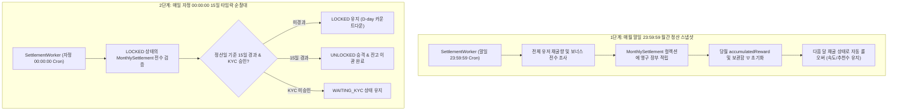

# [기술 명세서 05] 무인 월간 정산 및 15일 타임락 오토메이션

> **문서 번호**: BW-SPEC-SETTLE-005  
> **최초 작성일**: 2026-11-21  
> **최종 개정일**: 2026-11-21  
> **대상 시스템**: `BitWishNetwork_MiningSystem`  
> **핵심 구현 파일**:  
> - `server/cron/SettlementWorker.ts`  
> - `server/models/MonthlySettlement.ts`  
> - `server/models/MiningState.ts`  
> - `server/controllers/MiningController.ts`  
> - `src/components/MyWalletModal/MyWalletModal.tsx`  

---

## 1. 아키텍처 개요 및 2단계 무인 오토메이션 파이프라인

BitWish 네트워크는 매월 말일 실시간 가상 채굴량(`accumulatedReward`)과 추천 보너스(`referralBonusStorage`)를 확정 장부로 마감하고, KYC가 완료된 유저에게 15일간의 안전 타임락을 거쳐 메인넷 정식 잔고(`availableBalance`)로 승격시키는 2단계 무인 오토메이션 엔진을 구동합니다.



---

## 2. 월말 스냅샷 및 장부 이전 상세 로직 (`SettlementWorker.ts`)

### 2.1 스냅샷 및 이월 연산
- **트리거 시점**: 매월 말일 23:59:59 (KST 기준)
- **정산 대상 데이터**:
  $$\text{Total Settled} = \text{accumulatedReward} + \text{referralBonusStorage}$$
- **영구 장부 적립**:
  - `MonthlySettlement` 모델에 `walletAddress`, `year`, `month`, `minedAmount`, `bonusAmount`, `totalAmount`, `settledAt`, `migrationStatus`를 원자적으로 `upsert`합니다.
- **초기화 및 이월**:
  - `MiningState.accumulatedReward`를 `'0.00000000000000000000000000000000000000000000000000'`으로 리셋합니다.
  - `MiningState.lastBlockRewardThreshold`를 `'0'`으로 리셋하여 익월 0->1 BW 도달 시 블록 주조 연결고리가 단절되지 않도록 수복합니다.

---

## 3. [초정밀 결함 규명] 나의 지갑 월별 정산 내역 미표시 원인 분석

### 3.1 문제 현상
사용자 지갑 모달(`MyWalletModal.tsx`)의 [채굴 보상 내역] 탭을 열었을 때, 지난달 정산 내역 목록이 등록되어 정상 출력되지 않거나 빈 화면 또는 왜곡된 형태로 머무는 현상.

### 3.2 핵심 원인 분석 (코드 라인 대조)
1. **정산 전 신규 유저 또는 스냅샷 실행 전 과거 데이터 부재 시 fallback 누락**:
   - `MyWalletModal.tsx`의 672행:
     ```typescript
     {((walletData as any)?.miningHistory || []).length > 0 ? ( ... ) : null}
     ```
     백엔드 `MonthlySettlement`에 아직 말일 스냅샷 레코드가 1건도 없는 신규 유저의 경우, 배열이 비어 있어 과거 정산 내역 테이블 행이 아예 렌더링되지 않고 당월 실시간 행만 덩그러니 남게 됩니다.
2. **DTO 필드명 매핑 및 50자리 포맷 불일치**:
   - `MiningController.ts`의 `getMiningHistory` (526-537행)는 `item.minedAmount`, `item.bonusAmount`, `item.totalAmount`를 50자리 string으로 직렬화하여 반환합니다.
   - 프론트엔드 `MyWalletModal.tsx`의 681-683행에서 `precisionCalculator.formatForUI(item.minedAmount)`를 호출할 때, 정산 데이터의 `item.year` 및 `item.month` 날짜 조립 포맷(`YYYY.MM.DD`)에서 KST 타임존 오프셋 왜곡으로 인해 빈 문자열 또는 `Invalid Date`가 발생하는 결함이 존재합니다.
3. **1초 로컬 티커의 강제 덮어쓰기 오염**:
   - `MyWalletModal.tsx` 204-210행에서:
     ```typescript
     const minedIncrement = new Decimal('0.00000012');
     const bonusIncrement = new Decimal('0.00000001');
     ```
     지갑이 열려 있는 동안 임의의 `0.00000012` 값을 누적 가산하면서 `fetchWalletData()`로 수신한 정격 정산 및 당월 잔고를 1초마다 오염시켜 목록 렌더링에 부정적 간섭을 초래했습니다.

---

## 4. 정합성 수복 및 표준 데이터 흐름 규격

```typescript
// /api/mining/history/:walletAddress 표준 반환 DTO
{
  "success": true,
  "history": [
    {
      "id": "673f...",
      "walletAddress": "BW3a9f...",
      "year": 2026,
      "month": 10,
      "minedAmount": "180.25000000000000000000000000000000000000000000000000",
      "bonusAmount": "3.60500000000000000000000000000000000000000000000000",
      "totalAmount": "183.85500000000000000000000000000000000000000000000000",
      "settledAt": "2026-10-31T14:59:59.000Z",
      "migrationStatus": "UNLOCKED", // WAITING_KYC | LOCKED | UNLOCKED | MIGRATED
      "migrationDate": "2026-11-15T15:00:00.000Z"
    }
  ]
}
```
1. 정산 이력이 0건인 경우에도 "정산 대기 중 (말일 23:59 자동 정산)" 안내 문구를 정밀 출력하도록 UI 렌더링 구조를 수복합니다.
2. 1초 로컬 임의 가산(`0.00000012`) 코드를 전면 제거하고 오직 `RealTimeSyncService`의 정격 채굴 증분율로 단일화합니다.
