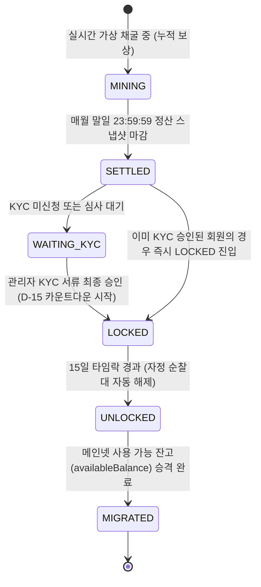

# [기술 명세서 06] 글로벌 KYC 거버넌스 및 자산 승격 체계

> **문서 번호**: BW-SPEC-KYC-006  
> **최초 작성일**: 2026-11-21  
> **최종 개정일**: 2026-11-21  
> **대상 시스템**: `BitWishNetwork_MiningSystem`  
> **핵심 구현 파일**:  
> - `server/routes/kyc.ts`  
> - `server/routes/admin.ts`  
> - `server/models/User.ts`  
> - `server/models/MonthlySettlement.ts`  
> - `src/components/MyWalletModal/MyWalletModal.tsx`  
> - `src/components/AdminPage/AdminPage.tsx`  

---

## 1. 아키텍처 개요 및 4단계 자산 전이 라이프사이클

BitWish 네트워크의 채굴 포인트는 어뷰징 및 봇 채굴을 원천 차단하기 위해 엄격한 신원 검증(KYC) 절차를 거쳐 실제 메인넷 자산으로 승격됩니다. 자산 상태는 다음과 같은 4단계 유한 상태 기계(FSM)를 따릅니다:



---

## 2. KYC 신청 및 관리자 거버넌스 파이프라인

### 2.1 신원 서류 제출 (`/api/kyc/apply`)
- **수집 데이터**: 실명, 생년월일, 국적, 신분증 유형(여권/주민등록증/운전면허증), 신분증 사본 파일
- **파일 업로드 처리**: `multer` 미들웨어를 통해 규격화된 암호화 스토리지 경로에 격리 저장
- **상태 전이**: 유저 도큐먼트 내 `kycApplication.status = 'PENDING'`, `submittedAt = new Date()`

### 2.2 관리자 심사 및 사각 승인 (`/api/admin/kyc/approve`)
- 관리자는 어드민 대시보드에서 제출된 신분증의 진위 여부를 대조 심사합니다.
- 승인 API 실행 시 원자적 상태 변경:
  1. `User.isKycVerified = true`
  2. `User.kycVerifiedDate = new Date()`
  3. `User.kycApplication.status = 'APPROVED'`
  4. 과거 `WAITING_KYC` 상태로 묶여 있던 해당 지갑의 모든 `MonthlySettlement` 레코드를 즉시 `LOCKED`로 일괄 승격하고 15일 타임락 타이머를 동기화 개시합니다.

---

## 3. 15일 타임락 계산 및 프론트엔드 실시간 D-Day 타이머

```typescript
// 프론트엔드 MyWalletModal.tsx L697-726 정합성 로직
const baseDate = kycVerifiedDate ? new Date(kycVerifiedDate) : new Date(item.settledAt);
const unlockDate = new Date(baseDate.getTime() + (15 * 24 * 60 * 60 * 1000));
const diff = unlockDate.getTime() - currentTime.getTime();

if (diff <= 0 || item.migrationStatus === 'UNLOCKED') {
    // 잠금 해제 (Available Balance 이관)
} else {
    // D-Day, 시간, 분, 초 역산 카운트다운 출력 (D-14 23:59:45)
}
```
- 매일 자정 구동되는 `SettlementWorker.executeTimelockRelease()` 백엔드 순찰대와 클라이언트 UI가 정확히 1초의 오차도 없이 연동되어 잠금 해제와 뱃지 전환이 실시간으로 이루어집니다.
