# [기술 명세서 07] 추천인 1BW 가입보상, 2% 채굴보너스 보관함 및 소셜 배포 시스템

> **문서 번호**: BW-SPEC-REF-007  
> **최초 작성일**: 2026-11-21  
> **최종 개정일**: 2026-11-27 (`공정 1-2` ~ `공정 4-4`, `관리자 시스템 2% 이중합산 수복`, `c-1공정 추천보너스 모달 UI/UX 및 4대 소셜 배포 전면 개편` 전체 반영 완료)  
> **대상 시스템**: `BitWishNetwork_MiningSystem`  
> **핵심 구현 파일**:  
> - 백엔드 라우트 & 컨트롤러: `server/routes/referral.ts`, `server/routes/admin.ts`, `server/controllers/MiningController.ts`, `server/controllers/UserController.ts`
> - 온체인 블록체인 코어: `server/services/BlockMiningService.ts`
> - 데이터베이스 모델: `server/models/BonusRecord.ts`, `server/models/User.ts`, `server/models/MiningState.ts`
> - 프론트엔드 동기화 서비스: `src/services/MiningService/RealTimeSyncService.ts`, `src/services/ApiService.ts`
> - UI/UX 컴포넌트 & 스타일: `src/components/ReferralModal/ReferralModal.tsx`, `src/components/ReferralModal/ReferralModal.css`, `src/components/HomePage/HomePage.tsx`, `src/components/MyWalletModal/MyWalletModal.tsx`

---

## 1. 아키텍처 개요 및 2대 보너스 이중화 보관함 구조

BitWish 추천 시스템은 단순한 링크 유입이 아닌, 네트워크 확장에 기여한 유저에게 2가지 차별화된 인센티브를 온체인과 오프체인이 결합된 형태로 제공합니다:

```mermaid
flowchart TD
    subgraph INCENTIVE_A["1. 신규 가입 1 BW 즉시 보상 (추천보상보관함)"]
        U1["신규 가입자 등록 시 추천인 코드 입력"] --> U2["추천인 & 피추천인 양자에게 각 1.0 BW 즉시 적립 (총 2.0 BW)"]
        U2 --> U3["BonusRecord.referralRewardStorage에 가산"]
        U3 --> U4["BlockMiningService 비동기 즉각 호출 (setImmediate)"]
        U4 --> U5["제네시스 오프셋 1 + floor(Issued) 기반 온체인 블록 자동 주조"]
        U5 --> U6["지갑 대시보드 [추천 보너스] 탭에 1.00000000 BW 즉시 표시"]
    end

    subgraph INCENTIVE_B["2. 피추천인 실시간 채굴 2% 누적 (추천보너스보관함)"]
        M1["피추천인이 실시간 틱 채굴 가동"] --> M2["피추천인 채굴량의 2%를 실시간 백그라운드 연산"]
        M2 --> M3["BonusRecord.referralBonusStorage에 지속 적립"]
        M3 --> M4["월말 정산 스냅샷 시 정규 채굴량과 함께 정산 합산"]
    end
```



---

## 2. [c-1 공정 최종 완성] 추천보너스 모달 UI/UX 및 원터치 소셜 배포 시스템

2026-11-27 `c-1 공정`을 통해 기존의 거대하고 반투명했던 모달을 **1/3 규격으로 슬림화**하고, **프리미엄 화이트-블루 투톤 테마**와 **4대 글로벌 SNS 즉시 배포 인텐트**를 탑재하여 바이럴 전파력을 극대화했습니다.

### 2.1 UI/UX 레이아웃 구조

```
┌────────────────────────────────────────────────────────┐
│  🎁 친구 초대하고 BW 받기                         [✕]   │  <- 상단 슬림 헤더 (우측 닫기 버튼)
├────────────────────────────────────────────────────────┤
│  SNS 간편 공유                                         │
│   ┌────────┐  ┌────────┐  ┌────────┐  ┌────────┐       │
│   │ 카카오톡 │  │ 텔레그램 │  │   𝕏    │  │페이스북 │       │  <- 4대 SNS 원터치 공유 그리드
│   └────────┘  └────────┘  └────────┘  └────────┘       │
│                                                        │
│  나의 추천 코드                                         │
│  ┌─────────────────────────────────┬──────────┐        │
│  │  REFE09BBF5F3538                │ 📋 코드복사│       │  <- 추천 코드 + 복사 일체형 컨테이너
│  └─────────────────────────────────┴──────────┘        │
│  💡 코드를 복사한 뒤 원하는 SNS를 클릭하면 즉시 초대      │
│     메시지가 전송됩니다!                                │
├────────────────────────────────────────────────────────┤
│  👥 초대 유저 1명     |     ⚡ 보너스율 +0%              │  <- 바닥 1줄 미니 요약 뱃지 바
└────────────────────────────────────────────────────────┘
```

### 2.2 비주얼 스타일 시스템 사양 (`ReferralModal.css`)
- **컬러 팔레트**:
  - `배경 (Background)`: `#FFFFFF` (반투명 및 흐림 효과 전면 배제, 100% 완전 불투명 솔리드 순백)
  - `메인 포인트 (Primary Accent)`: `#2563EB` (선명하고 신뢰감 있는 로열 블루)
  - `보조 포인트 (Secondary)`: `#1D4ED8` ~ `#1E40AF` (깊이 있는 딥 블루)
  - `헤더 타이틀 (Header Text)`: `#1E3A8A` (다크 네이비 블루)
  - `복사 성공 피드백 (Success)`: `#10B981` (산뜻한 에메랄드 그린)
- **모달 규격 및 그림자 (Shadow & Geometry)**:
  - `너비 (Width)`: `360px` 고정 슬림 규격 (`max-width: calc(100vw - 20px)`, `box-sizing: border-box`)
  - `라운딩 (Border Radius)`: `18px` (현대적인 부드러운 카드 곡률)
  - `입체 그림자 (Shadow)`: `box-shadow: 0 20px 25px -5px rgba(0, 0, 0, 0.1), 0 10px 10px -5px rgba(0, 0, 0, 0.04), 0 0 0 1px rgba(37, 99, 235, 0.05);`

### 2.3 4대 소셜 인텐트 및 복사 메커니즘 (`ReferralModal.tsx`)
1. **공통 마케팅 메시지 템플릿**:
   ```text
   [BitWish Network] 극초기 채굴 기회! 추천 코드 [추천코드] 입력 시 2 BW 즉시 지급 및 채굴 보너스 혜택!
   https://bitwish.network (도메인 URL)
   ```
2. **채널별 인텐트 규격**:
   - **카카오톡 (KakaoTalk)**: 초대 텍스트 자동 복사와 함께 웹 공유 창(`story.kakao.com/share` 또는 카카오 인텐트) 팝업.
   - **텔레그램 (Telegram)**: `https://t.me/share/url?url={URL}&text={Message}` 파라미터로 즉시 채팅방 공유창 호출.
   - **X (구 Twitter)**: `https://twitter.com/intent/tweet?text={Message}&url={URL}` 파라미터로 트윗 작성창 즉시 호출.
   - **페이스북 (Facebook)**: `https://www.facebook.com/sharer/sharer.php?u={URL}` 표준 다이얼로그 호출.
3. **원터치 복사 피드백**:
   - `[📋 코드복사]` 클릭 시 클립보드 저장 완료와 동시에 버튼 텍스트가 **`복사됨! ✅`** 로 전환되며, **1.5초** 후 원래 상태로 자동 복귀.

### 2.4 칼중앙 정렬 및 이중 렌더링 방지 아키텍처
1. **마이닝 모달 기준 칼중앙 정렬 좌표계**:
   - 마이닝 모달 폭(400px)의 중심축과 추천보너스 모달(360px)의 중심축을 완벽히 일치시키기 위해 수학적 대칭 좌표 공식 적용:
     $$\text{left} = \max\left(10, \operatorname{round}\left(\frac{\text{window.innerWidth} - 360}{2}\right)\right)$$
     $$\text{top} = \max\left(50, \operatorname{round}\left(\frac{\text{window.innerHeight} - 380}{2}\right)\right)$$
2. **단일 렌더링(Singleton) 무결성 보장**:
   - `HomePage.tsx` 내 중복 컴포넌트 선언을 영구 제거하여, 드래그 시 모달이 2개로 갈라지는 유령 복제(Ghosting) 현상을 근본적으로 차단.

---

## 3. 추천 보너스 연산 정밀도 및 선형 반감기 연동 무결성

### 3.1 50자리 Decimal 정규화 및 가짜 증분 원천 차단
1. **단위 정규화**:
   - `MiningState.referralBonusRate`는 유저 수 $\times 0.02$ 단위의 정밀 Decimal 배수로 단일화.
2. **문자열 기반 50자리 정밀 보존**:
   - `realTimeStatus.referralBonusStorage`를 string(`toFixed(50)`)으로 관리하여 IEEE 754 부동소수점(`toNumber()`)에 의한 소수점 유실을 원천 차단.
3. **단일 진실 소스(SSOT) 바인딩**:
   - 프론트엔드의 `0.00000001` 하드코딩을 제거하고 백엔드 단일 진실 소스와 `RealTimeSyncService`의 공식 증분만을 바인딩.

### 3.2 선형 반감기 연동 수식
추천 보너스의 모든 연산은 반감된 기본 채굴률 $R(m)$을 근본 기준으로 하여 직접 곱해지므로, 추천 자식 수가 아무리 늘어나도 반감기와 100% 정확하게 연동됩니다.

$$\text{초당 추천 보너스 증분} = \frac{R(m) \times B_{\text{ref}}}{3600\text{초}}$$

- $R(m)$: 현재 반감기 적용된 기본 채굴률 (예: 2개월차 $\rightarrow$ `0.22500000 BW/h`)
- $B_{\text{ref}}$: 추천 보너스 배율 (피추천인 1명당 `0.02`, $N$명이면 $0.02 \times N$)

| 추천 자식 수 | 추천 보너스율 ($B_{\text{ref}}$) | 반감기 없음 ($R_0=0.25$) | 2개월차 ($R(2)=0.225$) | 반감 비율 |
|:---:|:---:|:---:|:---:|:---:|
| 1명 | 2% | 0.00500000 BW/h | 0.00450000 BW/h | -10.0% ✅ |
| 10명 | 20% | 0.05000000 BW/h | 0.04500000 BW/h | -10.0% ✅ |
| 50명 | 100% | 0.25000000 BW/h | 0.22500000 BW/h | -10.0% ✅ |
| 100명 | 200% | 0.50000000 BW/h | 0.45000000 BW/h | -10.0% ✅ |

---

## 4. [관리자 시스템 수복] 전체 추천 보너스율 2% 이중 합산 버그 원천 차단

### 4.1 결함 원인 (수복 전)
과거 관리자 대시보드 API(`GET /api/admin/rewards/total`)에서 추천인 2%와 가입자 2%를 집계할 때, `BonusRecord`와 `MiningState`에서 동일 항목을 중복 합산하여 실제 4%가 나와야 할 2인 추천 관계에서 **6.00%로 뻥튀기 표출되던 결함**.

### 4.2 수복 공식 (`server/routes/admin.ts`)
`MiningState` 단일 원천 집계 방식으로 전면 수복하여 추천 1건당 정확히 **4.00% (추천인 2% + 피추천인 2%)** 로 전산 일치화 완료:
```typescript
// 시스템 전역 실제 부여된 추천 보너스율 순수 전수 합산 (단일 원천 집계)
const bonusRateResults = await MiningState.aggregate([
    { $group: { _id: null, total: { $sum: { $toDouble: { $ifNull: ["$referralBonusRate", "0"] } } } } }
]);

const totalBonusDecimal = bonusRateResults.length > 0 ? bonusRateResults[0].total : 0;
const finalTotalRate = totalBonusDecimal * 100; // 0.04 * 100 = 4.00%
```

---

## 5. 결론 및 향후 유지보수 지침

1. 추천보너스 모달은 **360px 화이트-블루 투톤** 디자인을 엄격히 준수하며, 반투명 스타일 복원을 엄격히 금지함.
2. 신규 SNS 채널 추가 시 `ReferralModal.tsx`의 `handleSocialShare` 스위치 문과 인텐트 URL 규격을 준수하여 등록할 것.
3. 추천 보상 및 보너스율 연산 시 항상 `Decimal.js` 50자리 정밀도를 유지하고, 부동소수점 다운캐스팅을 금지함.
