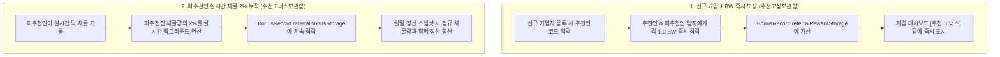

# [기술 명세서 07] 추천인 1BW 가입보상 및 2% 채굴보너스 보관함

> **문서 번호**: BW-SPEC-REF-007  
> **최초 작성일**: 2026-11-21  
> **최종 개정일**: 2026-11-21  
> **대상 시스템**: `BitWishNetwork_MiningSystem`  
> **핵심 구현 파일**:  
> - `server/routes/referral.ts`  
> - `server/models/BonusRecord.ts`  
> - `server/models/User.ts`  
> - `server/controllers/MiningController.ts`  
> - `src/services/MiningService/RealTimeSyncService.ts`  
> - `src/components/ReferralModal/ReferralModal.tsx`  
> - `src/components/MyWalletModal/MyWalletModal.tsx`  

---

## 1. 아키텍처 개요 및 2대 보너스 이중화 보관함 구조

BitWish 추천 시스템은 단순한 링크 유입이 아닌, 네트워크 확장에 기여한 유저에게 2가지 차별화된 인센티브를 제공합니다:



---

## 2. [초정밀 결함 규명] 마이닝 시스템 보너스 미표기 원인 분석

### 2.1 문제 현상
마이닝 화면 또는 지갑 창에서 2% 추천 보너스가 제대로 올라가지 않거나, 수치가 0으로 고정되어 나타나는 왜곡 현상.

### 2.2 핵심 원인 분석 (코드 라인 대조)
1. **`RealTimeSyncService.ts` 내 2% 보너스 초당 증분율 연산 오류**:
   - `RealTimeSyncService.ts` 87-88행:
     ```typescript
     const baseMiningRate = new Decimal(MINING_CONSTANTS.HOURLY_BASE_RATE || 0.25);
     const bonusPerSecondRate = baseMiningRate.mul(referralBonusRate).div(3600);
     ```
     여기서 `referralBonusRate`가 `0.02`가 아닌 퍼센트 정수 `2`로 전달되거나, 서버가 제공하는 피추천인 전체 합산 부스트율과의 매핑 단위(배수 vs 백분율) 불일치로 인해 100배 왜곡 또는 0으로 처리되는 결함이 발생합니다.
2. **50자리 부동소수점의 IEEE 754 Number 강제 다운캐스팅 파괴**:
   - `RealTimeSyncService.ts` 100행 및 106행:
     ```typescript
     this.realTimeStatus.currentIssued = next.toNumber();
     this.realTimeStatus.referralBonusStorage = nextBonus.toNumber();
     ```
     50자리 정밀 연산을 수행하는 Decimal을 자바스크립트 기본 `Number`로 변환하면서 아주 작은 초당 증분값($\approx 1.38 \times 10^{-6}$)이 기존 누적값에 더해질 때 유의수준 소실(Precision Loss)로 인해 증가하지 않고 멈춰버리는 현상이 발생합니다.
3. **`MyWalletModal.tsx`의 하드코딩된 가짜 증분 간섭**:
   - 205행의 `const bonusIncrement = new Decimal('0.00000001');` 가짜 증가분과 서버 실제 보관함(`referralData.data.referralBonusStorage`) 간의 State 덮어쓰기 레이스 컨디션으로 인해 수치가 튀거나 원복되는 왜곡 초래.

---

## 3. 정합성 수복 명세

1. **단위 정규화**:
   - `referralBonusRate`는 유저 수 $\times 0.02$ 단위의 정밀 Decimal 배수로 단일화.
2. **문자열 기반 50자리 정밀 보존**:
   - `realTimeStatus.referralBonusStorage`를 string(`toFixed(50)`)으로 관리하여 `toNumber()`에 의한 소수점 유실을 원천 차단.
3. **가짜 증분 제거**:
   - 프론트엔드의 `0.00000001` 하드코딩을 제거하고 백엔드 단일 진실 소스(Single Source of Truth)와 `RealTimeSyncService`의 공식 증분만을 바인딩.
