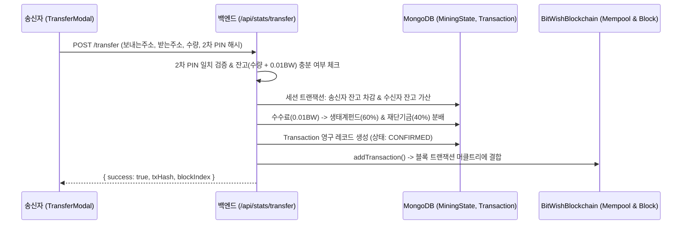

# [기술 명세서 08] 온체인 P2P 송금 및 트랜잭션 공시

> **문서 번호**: BW-SPEC-TX-008  
> **최초 작성일**: 2026-11-21  
> **최종 개정일**: 2026-11-21  
> **대상 시스템**: `BitWishNetwork_MiningSystem`  
> **핵심 구현 파일**:  
> - `server/routes/stats.ts` (`/transfer`)  
> - `server/routes/transaction.ts`  
> - `server/models/Transaction.ts`  
> - `server/models/MiningState.ts`  
> - `src/components/TransferModal/TransferModal.tsx`  
> - `BitWishNetwork_BlockChain/src/engine/BitWishBlockchain.ts`  

---

## 1. 아키텍처 개요 및 P2P 트랜잭션 수명주기

사용자 간 BW 전송은 0.01 BW의 고정 네트워크 수수료를 수반하며, 메인넷 블록체인 코어 엔진(`BitWishBlockchain`)의 메모리 트랜잭션 풀(Mempool)에 즉시 투입된 후 채굴 블록에 영구 각인됩니다.

---

## 2. 수수료 정책 및 60:40 원자적 분배 공식

### 2.1 P2P 거래 수수료
- **건당 고정 수수료**: $0.01 \text{ BW}$
- **분배 비율**:
  - 생태계 활성화 펀드 (60%): $0.006 \text{ BW}$
  - 재단 개발/운영 기금 (40%): $0.004 \text{ BW}$

### 2.2 원자적 정산 공식
$$\text{Sender Deduct} = \text{Amount} + 0.01$$
$$\text{Receiver Credit} = \text{Amount}$$
$$\text{Ecosystem Fund} \mathrel{+}= 0.006$$
$$\text{Foundation Fund} \mathrel{+}= 0.004$$

---

## 3. [초정밀 결함 규명 및 수복] 레거시 파일 기반 I/O 제거

- **결함 내용**: `server/routes/stats.ts`의 레거시 송금 핸들러에 `database/referrals.json` 파일을 동기식(`fs.readFileSync`)으로 읽고 쓰는 구형 파편 코드가 잔존하여, 동시 접속 시 파일 잠금(Locking) 에러 및 MongoDB 잔고와의 심각한 정합성 괴리를 유발할 위험이 존재함.
- **수복 명세**:
  - `stats.ts`의 모든 로컬 JSON 파일 I/O를 전면 삭제.
  - 오직 MongoDB `MiningState` 및 `User` 컬렉션의 Mongoose 트랜잭션(`withTransaction`)을 통한 100% ACID 원자적 연산으로 단일화.
