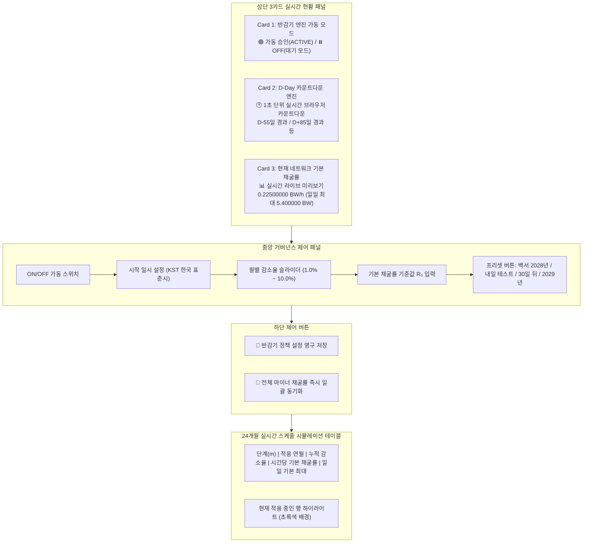

# [기술 명세서 10] 홈페이지 실시간 대시보드 및 관리자 사각 검증

> **문서 번호**: BW-SPEC-DASH-010  
> **최초 작성일**: 2026-11-21  
> **최종 개정일**: 2026-11-25 (`공정 4` 반감기 거버넌스 관리 콘솔 추가 반영)  
> **대상 시스템**: `BitWishNetwork_MiningSystem`  
> **핵심 구현 파일**:  
> - `src/components/HomePage/HomePage.tsx`  
> - `server/routes/stats.ts`  
> - `server/routes/admin.ts`  
> - `server/services/BlockMiningService.ts`  
> - `src/components/AdminPage/AdminPage.tsx`  

---

## 1. 홈페이지 6대 핵심 지표 실시간 집계 파이프라인

`HomePage.tsx` 상단 및 6개 정보 카드에는 전 세계 노드 및 채굴 상태를 대변하는 6대 지표가 실시간 스트리밍됩니다:

1. **총 공급량 (Total Supply)**: $1,000,000,000 \text{ BW}$ (10억 고정)
2. **현재 발행량 (Current Issued)**: 전체 유저 누적 채굴량 + 보너스 발행량의 실시간 합산
3. **잔여 발행 가능량 (Remaining Supply)**: $1,000,000,000 - \text{Current Issued}$
4. **네트워크 채굴률 (Issuance Rate)**: $(\text{Current Issued} / 1,000,000,000) \times 100\%$
5. **생성된 블록 수 (Total Blocks)**: $\lfloor \text{Total Issued} \rfloor + 1$ (Genesis 포함 칼동기화)
6. **활성 지갑 수 (Total Wallets)**: MongoDB `User` 컬렉션의 실제 등록된 지갑 수

---

## 2. 관리자 사각 검증 (Cross-Verification) 아키텍처

### 2.1 4개 컬렉션 간 데이터 교차 검증
관리자 페이지(`/admin`)는 시스템 내 자산 무결성을 위해 4개 핵심 컬렉션을 상호 대조하는 전수 감사(Audit) 엔진을 제공합니다:

$$\text{User.walletAddress} \iff \text{MiningState} \iff \text{BonusRecord} \iff \sum \text{MonthlySettlement}$$

- 어느 한 곳이라도 레코드가 누락되거나 합산 수치가 불일치할 경우 경고 뱃지를 표출하고, 단 1회의 클릭으로 불일치 데이터를 자동 수복(`auditAndFixDataIntegrity`)합니다.
- 관리자 하드 리셋 시에도 제네시스 지갑 및 시스템 필수 펀드 계정은 엄격히 보존되는 보호 메커니즘을 구비하고 있습니다.

---

## 3. `[공정 4 수복]` 반감기 정책 거버넌스 관리 콘솔 (`HalvingManager.tsx`)

> [!IMPORTANT]
> `공정 4` 수복을 통해 관리자 페이지에 **선형 반감기 거버넌스 관리 콘솔**이 완전히 신규 탑재되었습니다. 상세 엔진 구현은 [기술 명세서 14](file:///c:/BitWishNetwork_BlockChainMainnet/BitWishNetwork_Project_Reports/2026-11-21_New%20각%20기능%20시스템별%20기술%20명세서%20보관함/20261125_최종정립_14_선형_반감기_거버넌스_정책_엔진_및_무인_자동감산_기술명세서.md)에 전체 명세가 수록되어 있습니다.

### 3.1 구현 파일 및 위치
- **프론트엔드 컴포넌트**: [`src/components/AdminPage/HalvingManager.tsx`](file:///c:/BitWishNetwork_BlockChainMainnet/BitWishNetwork_MiningSystem/src/components/AdminPage/HalvingManager.tsx) (784행)
- **백엔드 API 엔드포인트**: [`server/routes/admin.ts`](file:///c:/BitWishNetwork_BlockChainMainnet/BitWishNetwork_MiningSystem/server/routes/admin.ts)
- **코어 연산 엔진**: [`server/services/HalvingPolicyEngine.ts`](file:///c:/BitWishNetwork_BlockChainMainnet/BitWishNetwork_MiningSystem/server/services/HalvingPolicyEngine.ts)

### 3.2 관리 콘솔 UI 구성 요소

### 3.3 핵심 기능 목록

| 기능 | 설명 | 구현 상태 |
|:---|:---|:---:|
| **2단계 안전 승인 체계** | ON/OFF 스위치 조작 후 별도 `[영구 저장]` 버튼 클릭 필수 → 실수 방지 | ✅ |
| **1초 D-Day 카운트다운** | 브라우저에서 1초 간격으로 시작일까지 남은 일/시/분/초 실시간 표시 | ✅ |
| **24개월 스케줄 시뮬레이션** | 시작일·감소율 변경 시 24단계 월별 채굴률 테이블 실시간 자동 갱신 | ✅ |
| **현재 적용 구간 하이라이트** | 시뮬레이션 테이블에서 현재 적용 중인 반감기 차수 행 강조 표시 | ✅ |
| **전체 마이너 즉시 동기화** | 버튼 1회 클릭으로 모든 활성 마이너의 MiningState DB 채굴률 일괄 갱신 | ✅ |
| **프리셋 버튼** | 백서 기준(2028년), 내일(테스트), 30일 뒤, 2029년(미루기) 1클릭 설정 | ✅ |
| **Card 3 라이브 미리보기** | 현재 반감기 적용된 유효 채굴률을 실시간 라이브로 카드에 표시 | ✅ |
