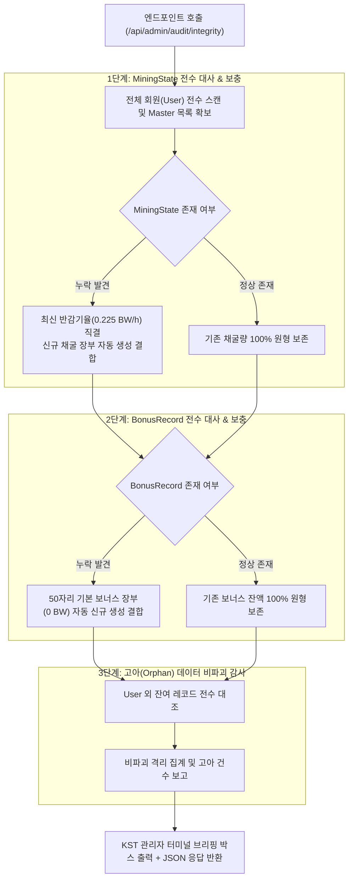
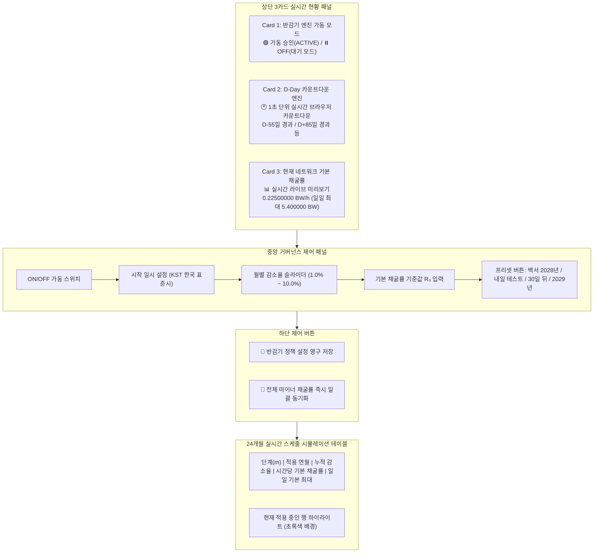

# [기술 명세서 10] 홈페이지 실시간 대시보드 및 관리자 사각 검증

> **문서 번호**: BW-SPEC-DASH-010  
> **최초 작성일**: 2026-11-21  
> **최종 개정일**: 2026-11-28 (크롬 확장프로그램 부스트 정책 거버넌스 제어 콘솔 `ExtensionPolicyManager` 신설 반영)  
> **대상 시스템**: `BitWishNetwork_MiningSystem`  
> **핵심 구현 파일**:  
> - `src/components/HomePage/HomePage.tsx`  
> - `server/routes/stats.ts`  
> - `server/routes/admin.ts`  
> - `server/services/HalvingPolicyEngine.ts`  
> - `server/services/BlockMiningService.ts`  
> - `src/components/AdminPage/AdminPage.tsx`  
> - `src/components/AdminPage/ExtensionPolicyManager.tsx`  

---

## 1. 홈페이지 6대 핵심 지표 실시간 집계 파이프라인

`HomePage.tsx` 상단 및 6개 정보 카드에는 전 세계 노드 및 채굴 상태를 대변하는 6대 지표가 실시간 스트리밍됩니다:

1. **총 공급량 (Total Supply)**: $1,000,000,000 \text{ BW}$ (10억 고정)
2. **현재 발행량 (Current Issued)**: 전체 유저 누적 채굴량 + 보너스 발행량의 실시간 합산
3. **잔여 발행 가능량 (Remaining Supply)**: $1,000,000,000 - \text{Current Issued}$
4. **네트워크 채굴률 (Issuance Rate)**: $(\text{Current Issued} / 1,000,000,000) \times 100\%$
5. **생성된 블록 수 (Total Blocks)**: $\lfloor \text{Total Issued} \rfloor + 1$ (Genesis 포함 칼동기화)
6. **활성 지갑 수 (Total Wallets)**: MongoDB `User` 컬렉션의 실제 등록된 지갑 수

---

## 2. `[공정 7 정밀 수복]` 4대 전산 장부 원클릭 대사(Audit) 및 무결성 자동 수복 엔진 아키텍처

### 2.1 4대 전산 장부 상호 연계 및 사각 검증 개요
BitWish Network는 유저 1명당 4개의 핵심 MongoDB 장부가 상호 유기적으로 결합되어 자산이 운용됩니다:

$$\text{User (신상 카드)} \iff \text{MiningState (채굴 통장)} \iff \text{BonusRecord (보너스 장부)} \iff \sum \text{MonthlySettlement (정기 정산 금고)}$$

| 장부 컬렉션 | 역할 및 핵심 데이터 | 정합성 검증 기준 |
| :--- | :--- | :--- |
| **`User`** | 지갑 주소, 니모닉 해시, 추천인 코드, 가입 IP | 전체 회원의 기준 원장 (Master Record) |
| **`MiningState`** | 실시간 채굴 상태, 누적 채굴량, 기본/총 채굴률, 출석 여부 | `User` 지갑과 1:1 필수 결합 (누락 시 채굴 불가) |
| **`BonusRecord`** | 1BW 가입 보상, 2% 추천 보너스 보관함 (50자리 정밀도) | `User` 지갑과 1:1 필수 결합 (누락 시 보너스 유실) |
| **`MonthlySettlement`** | 매월 1일 자정 확정 정산 잠금 수량 및 마이그레이션 상태 | 매월 말일 기준 누적 채굴 데이터의 영구 기록 |

---

### 2.2 금융권 수준의 절대 안전 원칙 (Safety Guard)
1. **기존 데이터 100% 영구 보존 원칙 (절대 삭제 금지)**:
   * 회원의 기존 채굴량(`accumulatedReward`), 보너스 잔액(`referralBonusStorage`), 정산 내역은 **단 0.0001%도 임의 삭제하거나 변경하지 않음**.
   * 오직 **"누락된 짝 장부만 안전하게 신규 보충"**하여 1:1:1:1을 맞춤.
2. **반감기 코어 엔진 실시간 직결 원칙**:
   * 누락된 `MiningState`를 신규 생성할 때, 낡은 0.25 고정값이 아닌 `HalvingPolicyEngine.getCurrentBaseRate()`를 실시간 호출하여 **현재 2차 반감기율(`0.22500000 BW/h`)을 정확히 부여**.
3. **유령 데이터 비파괴 격리 보고 원칙**:
   * `User`에 등록되지 않은 지갑의 잔여 레코드(Orphan)가 발견될 경우 강제 삭제하지 않고, **[감사 리포트]에 상세 주소와 금액을 명시하여 관리자에게 안전 보고**.

---

### 2.3 3단계 감사 및 자동 수복 파이프라인



---

### 2.4 API 엔드포인트 명세

* **경로**: `/api/admin/audit/integrity`
* **메서드**: `ALL` (`GET` 및 `POST` 전천후 지원 → 브라우저 주소창 직접 호출 및 관리자 UI 연동 지원)
* **응답 규격 (JSON)**:
  ```json
  {
    "success": true,
    "message": "4대 전산 장부 정합성 감사 및 자동 수복이 100% 완료되었습니다.",
    "data": {
      "totalUsers": 3,
      "miningFixedCount": 0,
      "bonusFixedCount": 0,
      "orphanCount": 0,
      "orphanMining": [],
      "orphanBonus": [],
      "effectiveBaseRate": "0.22500000",
      "auditTimestamp": "2026-11-26T04:16:07.159Z"
    }
  }
  ```

---

### 2.5 KST 관리자 콘솔 정밀 감사 브리핑 규격

감사 엔진이 가동되는 즉시 백엔드 터미널에 아래와 같은 최고급 브리핑 박스가 자동으로 출력됩니다:

```text
═══════════════════════════════════════════════════════════════════════════════
 [BitWish Audit] 🛡️ 4대 전산 장부 무결성 전수 감사 및 수복 결과
───────────────────────────────────────────────────────────────────────────────
 • 총 회원 수 (User)        : 3명
 • 채굴 통장 수복 (Mining)   : 0건 신규 생성 보충 (정상 1:1 일치)
 • 보너스 장부 수복 (Bonus)  : 0건 신규 생성 보충 (정상 1:1 일치)
 • 고아/유령 데이터 감지    : 0건 (완전 무결)
 • 적용 기준 기본 채굴률   : 0.22500000 BW/h (반감기 실시간 직결)
 • 4대 장부 최종 정합성     : 100% 무결점 정렬 완료 ✅
═══════════════════════════════════════════════════════════════════════════════
```

---

## 3. `[공정 4 수복]` 반감기 정책 거버넌스 관리 콘솔 (`HalvingManager.tsx`)

> [!IMPORTANT]
> `공정 4` 수복을 통해 관리자 페이지에 **선형 반감기 거버넌스 관리 콘솔**이 완전히 신규 탑재되었습니다. 상세 엔진 구현은 [기술 명세서 14](file:///c:/BitWishNetwork_BlockChainMainnet/BitWishNetwork_Project_Reports/2026-11-21_New%20각%20기능%20시스템별%20기술%20명세서%20보관함/20261125_최종정립_14_선형_반감기_거버넌스_정책_엔진_및_무인_자동감산_기술명세서.md)에 전체 명세가 수록되어 있습니다.

### 3.1 구현 파일 및 위치
- **프론트엔드 컴포넌트**: [`src/components/AdminPage/HalvingManager.tsx`](file:///c:/BitWishNetwork_BlockChainMainnet/BitWishNetwork_MiningSystem/src/components/AdminPage/HalvingManager.tsx) (784행)
- **백엔드 API 엔드포인트**: [`server/routes/admin.ts`](file:///c:/BitWishNetwork_BlockChainMainnet/BitWishNetwork_MiningSystem/server/routes/admin.ts)
- **코어 연산 엔진**: [`server/services/HalvingPolicyEngine.ts`](file:///c:/BitWishNetwork_BlockChainMainnet/BitWishNetwork_MiningSystem/server/services/HalvingPolicyEngine.ts)

### 3.2 관리 콘솔 UI 구성 요소



### 3.3 핵심 기능 목록

| 기능 | 설명 | 구현 상태 |
|:---|:---|:---:|
| **2단계 안전 승인 체계** | ON/OFF 스위치 조작 후 별도 `[영구 저장]` 버튼 클릭 필수 → 실수 방지 | ✅ |
| **1초 D-Day 카운트다운** | 브라우저에서 1초 간격으로 시작일까지 남은 일/시/분/초 실시간 표시 | ✅ |
| **24개월 스케줄 시뮬레이션** | 시작일·감소율 변경 시 24단계 월별 채굴률 테이블 실시간 자동 갱신 | ✅ |
| **현재 적용 구간 하이라이트** | 시뮬레이션 테이블에서 현재 적용 중인 반감기 차수 행 강조 표시 | ✅ |
| **전체 마이너 즉시 동기화** | 버튼 1회 클릭으로 모든 활성 마이너의 MiningState DB 채굴률 일괄 갱신 | ✅ |
| **프리셋 버튼** | 백서 기준(2028년), 내일(테스트), 30일 뒤, 2029년(미루기) 1클릭 설정 | ✅ |
| **Card 3 라이브 미리보기** | 현재 반감기 적용된 유효 채굴률을 실시간 라이브로 카드에 표시 | ✅ |

---

## 4. [공정 1 거버넌스 수복] 크롬 확장프로그램 부스트 정책 거버넌스 콘솔 (`ExtensionPolicyManager.tsx`)

> [!IMPORTANT]
> 2026년 11월 28일 `d` 공정 1을 통해, 관리자 페이지에 **크롬 확장프로그램 부스트 정책 거버넌스 콘솔(`ExtensionPolicyManager.tsx`)**이 신규 탑재되었습니다.

### 4.1 구현 파일 및 아키텍처
- **프론트엔드 컴포넌트**: [`src/components/AdminPage/ExtensionPolicyManager.tsx`](file:///c:/BitWishNetwork_BlockChainMainnet/BitWishNetwork_MiningSystem/src/components/AdminPage/ExtensionPolicyManager.tsx)
- **백엔드 거버넌스 API**: [`server/routes/admin.ts`](file:///c:/BitWishNetwork_BlockChainMainnet/BitWishNetwork_MiningSystem/server/routes/admin.ts) (`GET/POST /api/admin/extension/policy`)
- **데이터베이스 모델**: [`server/models/SystemConfig.ts`](file:///c:/BitWishNetwork_BlockChainMainnet/BitWishNetwork_MiningSystem/server/models/SystemConfig.ts) (`extension_policy`)

### 4.2 핵심 기능 및 UI 규격
1. **베타 30% ↔ 정규 10% 원클릭 전환**:
   - 관리자가 클릭 한 번으로 서비스 초기 베타 부스트(30%)에서 정규 상용 부스트(10%)로 즉시 하향 전환 가능.
2. **50자리 정밀도 요율 보존**:
   - `0.30000000000000000000000000000000000000000000000000` / `0.10000000000000000000000000000000000000000000000000` 표준 포맷 보존.
3. **전 세계 크롬 팝업 및 채굴률 즉시 자동 동기화**:
   - 정책 저장 즉시 백엔드 `mining.ts` 및 확장프로그램 팝업 UI(`popup.js`)에 동시 반영.

