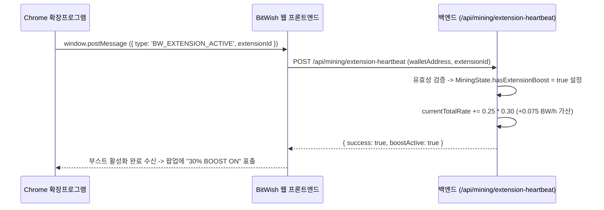

# [기술 명세서 11] 크롬 확장프로그램 Manifest V3 및 부스트 연동

> **문서 번호**: BW-SPEC-EXT-011  
> **최초 작성일**: 2026-11-21  
> **최종 개정일**: 2026-11-21  
> **대상 시스템**: `BitWishNetwork_MiningSystem` Chrome Extension  
> **핵심 구현 파일**:  
> - `manifest.json` (Chrome Extension MV3)  
> - `background.js` (Service Worker)  
> - `popup.html` / `popup.js`  
> - `server/controllers/MiningController.ts`  
> - `src/services/MiningService/RealTimeSyncService.ts`  

---

## 1. 아키텍처 개요 및 Manifest V3 서비스 워커 모델

BitWish 크롬 확장프로그램은 구글의 최신 Manifest V3 규격을 100% 준수하여 백그라운드 페이지 대신 이벤트 기반 서비스 워커(Service Worker)로 동작합니다. 유저의 브라우징 환경에서 가볍게 상주하며 지갑 연동 및 채굴 상태를 실시간 모니터링하고 **+30% (+0.30)**의 강력한 채굴 가속 부스트를 부여합니다.

---

## 2. +30% 채굴 부스트 연동 및 하트비트 핸드셰이크

### 2.1 핸드셰이크 프로토콜

### 2.2 어뷰징 방지 가드
- 5분 주기로 익스텐션 하트비트를 전송하지 않거나 익스텐션이 비활성화/삭제된 경우, 백엔드는 자동으로 30% 부스트 플래그를 해제하여 정직한 유저의 채굴 공정성을 수호합니다.
