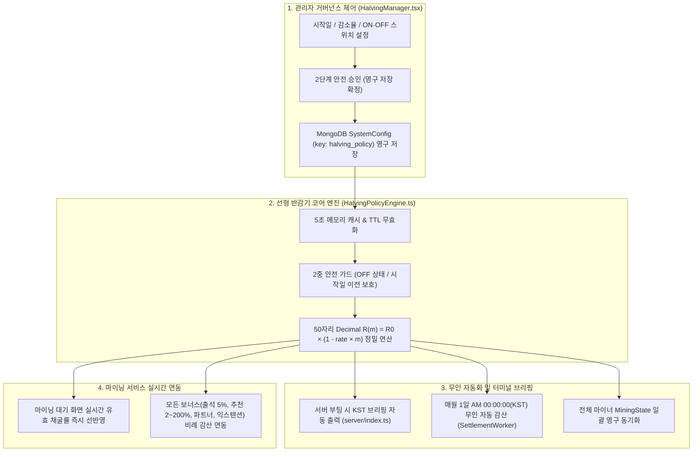

# [기술 명세서 14] 선형 반감기 거버넌스 정책 엔진 및 무인 자동 감산 시스템

> **문서 번호**: BW-SPEC-GOV-014  
> **최초 작성일**: 2026-11-25  
> **최종 개정일**: 2026-11-25 (`공정 4` ~ `공정 4-4` 수복 완료 반영)  
> **대상 시스템**: `BitWishNetwork_MiningSystem`  
> **핵심 구현 파일**:  
> - `server/models/SystemConfig.ts` (DB 모델 및 영구 보존 스키마)  
> - `server/services/HalvingPolicyEngine.ts` (선형 반감기 코어 연산 엔진)  
> - `server/routes/admin.ts` (관리자 거버넌스 API 엔드포인트)  
> - `server/cron/SettlementWorker.ts` (매월 1일 자정 무인 자동 감산 크론)  
> - `server/index.ts` (서버 부팅 시 정밀 브리핑 자동 출력)  
> - `server/controllers/MiningController.ts` (마이닝 채굴률 반감기 직결 연동)  
> - `src/components/AdminPage/HalvingManager.tsx` (관리자 거버넌스 제어 콘솔)  
> - `src/components/MiningStatusModal/MiningStatusModal.tsx` (마이닝 대기 화면 실시간 선반영)  
> - `src/services/ApiService.ts` (표준 통신 파이프라인)  

---

## 1. 아키텍처 개요 및 설계 원칙

BitWish Network의 선형 반감기 거버넌스 시스템은 백서 v1.0 §1.4의 공식을 충실히 구현하며, 비트코인식 4년 급격 반감의 충격을 완화하기 위해 **"매월 5.0% 선형 감산"** 체계를 기본으로 채택합니다.

또한, 메인넷 런칭 일정 및 폐쇄형 베타 환경에 맞추어 관리자가 시작일과 감소율을 자유롭게 조정할 수 있는 **[관리자 거버넌스 제어 콘솔]**과 **[무인 자동 감산 오토메이션 엔진]**을 완벽하게 통합하였습니다.



---

## 2. 수학적 공식 및 50자리 부동소수점 거버넌스

### 2.1 백서 v1.0 §1.4 선형 반감기 공식
시간당 기본 채굴률 $R(m)$은 반감기 공식 개시 후 경과 개월 수($m$)에 따라 선형적으로 감소합니다:

$$R(m) = \max\left(0, \; R_0 \times \Big(1 - \text{monthlyReductionRate} \times m\Big)\right)$$

* $R_0$: 기본 채굴률 기준값 ($0.25000000 \text{ BW/h}$)
* $\text{monthlyReductionRate}$: 월별 감소율 ($5.0\% = 0.05$)
* $m$: KST(한국 표준시) 기준 시작일로부터 경과한 개월 수 ($m = 0, 1, 2, \dots$)
* $m = 0$ (시작월): $R(0) = 0.25000000 \text{ BW/h}$ ($100\%$ 정상 공급)
* $m = 1$ (1개월 경과): $R(1) = 0.23750000 \text{ BW/h}$ ($-5.0\%$ 1차 감산)
* $m = 2$ (2개월 경과): $R(2) = 0.22500000 \text{ BW/h}$ ($-10.0\%$ 2차 감산)
* $m \ge 20$: $R(m) = 0.00000000 \text{ BW/h}$ (채굴 한도 도달, 보너스 전용 전환)

### 2.2 모든 보너스 배율의 반감기 기본 채굴률 직결 곱연산 원칙
유저의 최종 시간당 채굴 속도($\text{TotalRate}$)와 초당 추천 보너스 적립량은 반감된 기본 채굴률($R(m)$)을 근본 뿌리로 하여 직접 곱해집니다:

$$\text{TotalRate} = R(m) \times (1 + B_{\text{att}}) \times (1 + B_{\text{ref}}) \times (1 + B_{\text{partner}}) \times (1 + B_{\text{ext}})$$

$$\text{초당 추천 보너스 증분} = \frac{R(m) \times B_{\text{ref}}}{3600\text{초}}$$

* **무결성 보장**: 추천 자식 수가 늘어나 추천 보너스가 2%든, 20%든, 200%든 상관없이, 기준이 되는 $R(m)$이 반감되면 유저가 수령하는 최종 채굴량과 보너스도 단 1의 오차 없이 동일한 비율로 정확하게 반감됩니다.

---

## 3. 핵심 아키텍처 및 구현 컴포넌트

### 3.1 MongoDB 영구 보존 스키마 (`SystemConfig.ts`)
* `key: 'halving_policy'`
* **필드 구성**:
  ```typescript
  export interface IHalvingPolicyConfig {
      isEnabled: boolean;           // 가동 승인 여부 (true: 가동, false: 대기)
      startDate: string;            // 반감기 시작 일시 (KST 기준 ISO 타임스탬프)
      monthlyReductionRate: number; // 월별 채굴 감소율 (기본값: 5.0%)
      baseRate: number;             // 기본 채굴률 기준값 (0.25 BW/h)
      description?: string;         // 정책 설명/메모
      updatedAt?: Date;             // 최종 수정 일시
      updatedBy?: string;           // 수정한 관리자 계정
  }
  ```
* **데이터베이스 초기화 보호 규정**: `bitwish_mining` 컬렉션 초기화 시, `systemconfigs` 컬렉션은 **[그룹 B: 절대 삭제 금지/영구 보존]**으로 지정되어 관리자의 거버넌스 정책이 항상 안전하게 보존됩니다.

### 3.2 2중 안전 가드 (Safety Guard)
1. **1차 가드 (`isEnabled === false`)**: 관리자가 승인하지 않은 대기 모드에서는 날짜와 관계없이 무조건 $0.25000000 \text{ BW/h}$ 유지.
2. **2차 가드 (`now < startDate`)**: 가동 승인되었으나 아직 시작일 이전(D-Day 카운트다운 중)인 경우 무조건 $0.25000000 \text{ BW/h}$ 정상 공급 유지.

### 3.3 2단계 안전 승인 체계 (Two-Step Deliberate Confirmation)
* 관리자가 실수로 스위치를 터치하여 네트워크 전체의 금융 정책이 즉각 뒤바뀌는 대형 사고를 원천 방지하기 위해, **스위치 조작 후 파란색 `[반감기 정책 설정 영구 저장]` 버튼을 명시적으로 눌러야만 MongoDB에 확정 기록**되는 중후한 2단계 승인 체계를 유지합니다.

---

## 4. 백엔드 무인 오토메이션 및 터미널 정밀 브리핑

### 4.1 KST 기준 정밀 브리핑 박스 엔진 (`printGovernanceBriefing`)
관리자 정책 저장 시, 그리고 서버 재기동 시 터미널에 아래와 같은 최고급 브리핑 박스가 자동 출력됩니다:

```text
═══════════════════════════════════════════════════════════════════════════════
 [BitWish Governance] 🚀 선형 반감기 실시간 발동 종합 브리핑
───────────────────────────────────────────────────────────────────────────────
 • 엔진 가동 상태   : 🚀 ON (선형 반감기 실시간 공식 발동 중)
 • 반감기 시작 일시 : 2026년 09월 01일 AM 12:00:00 (KST 한국 표준시)
 • 시작일 경과 일수 : 시작일 기준 D+85일 경과 (현재 2차 반감기 구간)
 • 현재 적용 감소율 : -10.0% 선형 감산 적용 중
 • 현재 기본 채굴률 : 0.22500000 BW/h (일일 최대 5.400000 BW / 24h)
 • 다음 3차 반감기  : 2026년 12월 01일 AM 12:00:00 (KST 한국 표준시)부터 누적 -15.0% 감산 발동 (0.21250000 BW/h)
═══════════════════════════════════════════════════════════════════════════════
```

### 4.2 서버 부팅 시 브리핑 자동 출력 연동 (`server/index.ts`)
* 서버 기동 완료(`app.listen`) 시 비동기로 `HalvingPolicyEngine.getHalvingStatus()`를 즉시 호출하여 현재 정책 브리핑을 터미널에 1초 만에 자동 표출합니다.

### 4.3 매월 1일 자정 무인 자동 감산 스케줄러 (`SettlementWorker.ts`)
* 크론 표현식: `'0 0 1 * *'` (매월 1일 AM 00:00:00, 타임존 `Asia/Seoul`)
* 새 달이 되는 순간, 무인 자동으로 반감기 차수를 계산하고, 브리핑을 출력하며, 전체 활성 마이너들의 `MiningState` DB 장부에 새 채굴률을 100% 무인 자동 동기화합니다.

### 4.4 마이닝 대기 화면 실시간 채굴률 즉시 선반영 (`MiningController.ts` & `MiningStatusModal.tsx`)
* 신규 가입자 또는 채굴 시작 전 대기 상태(00:00:00)에서도, 백엔드로부터 최신 반감기 유효 채굴률을 직결 전달받아 첫 화면부터 정확한 반감 채굴률(예: 2차 반감기 추천 2% 시 `0.22950000 BW`)을 오차 없이 표출합니다.
