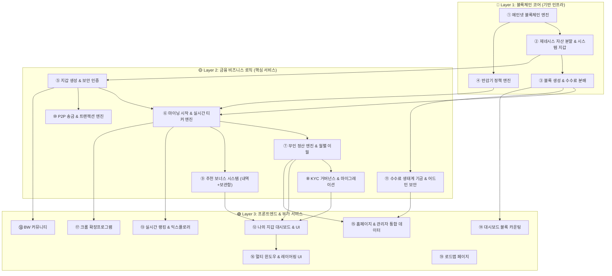

# 📋 BitWish Network 기술 명세서 재분석 작업 계획서
## Technical Specification Re-Analysis & Rewrite Work Plan

**작성일:** 2026-11-21  
**목적:** 기존 27개 기술 명세서의 체계적 재분석 → 시스템 로직 연결성 검증 → 명세서 재작성 순서 확정

---

## 🔍 1. 현행 명세서 총괄 진단 (Critical Assessment)

### 1.1 공통 문제점 (전 명세서에 걸친 구조적 결함)

| 문제 유형 | 상세 설명 |
|:---|:---|
| **시스템 간 연결 로직 미기술** | 각 명세서가 독립적으로 작성되어 모듈 간 데이터 흐름·API 호출 관계·이벤트 체인이 명시되지 않음 |
| **중복 & 파편화** | 동일 시스템(랭킹, 정산, 수복)이 2~3개 명세서에 분산 기술되어 어떤 것이 최종본인지 불명확 |
| **버그 수복 일지 혼재** | 기술 명세서와 버그 수복 보고서가 혼합되어, 현재 시스템의 "정상 작동 사양"을 파악하기 어려움 |
| **백서와의 정합성 미검증** | 백서에 명시된 토큰 이코노미·반감기·수수료 구조가 실제 코드/명세서와 정확히 일치하는지 미검증 |
| **데이터 모델 정의 부재** | MongoDB 컬렉션/필드 구조의 통합 스키마 명세가 없어 시스템 전체 데이터 흐름 추적 불가 |
| **에러 핸들링·장애 대응 미흡** | 네트워크 오류, DB 장애, 동시성 문제 등의 예외 처리 명세 거의 없음 |

### 1.2 중복 명세서 식별

| 중복 그룹 | 파일명 | 판단 |
|:---|:---|:---|
| **랭킹 시스템** (2건) | `BitWish 실시간 랭킹 시스템 및 블록 익스플로러 검색 엔진 기술 명세서.md` | 구버전 |
| | `20260506_BW_실시간_랭킹_시스템_및_검색_엔진_기술_명세서.md` | 신버전 (내용 거의 동일, 일부 보강) |
| **채굴 정산 & 수복** (2건) | `BitWish 채굴 보상 내역 및 실시간 정산·이월 정합성 최종 기술 명세서.md` | 정산 로직 + 수복 혼합 |
| | `BitWish 채굴 정산 내역 마이닝데이터 초기화 되지 않도록 정합성 수복 및 지갑 UI 아키텍처 개조 기술 명세서.md` | 위와 90% 중복 (수복 관점) |
| **마이그레이션** (2건) | `BitWish KYC_거버넌스_마이그레이션_...기술_명세서.md` | 통합본 (가장 포괄적) |
| | `BitWish 마이그레이션 데이터 무결성 수복 및 트리거 체인 고도화...기술 명세서.md` | 위의 Phase 1-3 보강 |

---

## 🏗️ 2. 재분석 계층 구조 (Layered Analysis Framework)

시스템을 **코어 → 미들 → 프론트** 3계층으로 분류하고, 의존 관계에 따라 **아래(기반)부터 위(표현)로** 순서를 정합니다.



---

## 📌 3. 재분석 & 재작성 우선순위 (19단계 작업 순서)

> [!IMPORTANT]
> **원칙: 기반(코어)부터 → 비즈니스 로직 → 프론트엔드 순서로 진행합니다.**
> 하위 시스템을 먼저 확정해야 상위 시스템의 연결 로직을 정확히 기술할 수 있습니다.


=================================================================================================


### 🔴 Phase 1: 블록체인 코어 계층 (최우선)

| 순서 | 명세서 명 | 기존 파일(들) | 재분석 포인트 | 중요도 |
|:---:|:---|:---|:---|:---:|
| **①** | **메인넷 블록체인 독립 엔진** | `BitWish 메인넷 블록체인 독립 기술 명세서.md` | BWVM 실제 구현 여부, PoW 합의 알고리즘 상세, 블록 구조체 필드 정의, `BitWishBlockchain.ts` 코드와의 일치 검증. 백서 §3.1의 "1BW 돌파 시 블록 생성" 로직과 명세서 §4.2의 "50BW/블록 보상 + 210,000블록 반감기" **상충** 해소 필요 | ⭐⭐⭐ |
| **②** | **제네시스 자산 분할 & 시스템 지갑** | `BitWish 메인넷 제네시스 자산 분할...기술 명세서.md` | 5대 시스템 지갑(백서 §1.5) 중 수수료 지갑 2개(`ECOSYSTEM_FEE_60`, `DEV_FEE_40`)의 제네시스 생성 로직 미기술. 3개 풀(65:15:20) 외 나머지 2개 지갑 초기화 과정 보완 필요 | ⭐⭐⭐ |
| **③** | **블록 생성 수수료 & 분배 체계** | `BitWish 블록 생성 수수료 및 분배 체계...기술 명세서.md` + `20260419_BW_네트워크_수수료...기술 명세서.md` | 블록 수수료(0.001BW)와 P2P 거래 수수료(0.01BW)의 통합 분배 로직, `network_stats` 도큐먼트 갱신 타이밍, 60:40 원자적 분배의 실제 코드 경로 검증 | ⭐⭐⭐ |
| **④** | **반감기 정책 엔진** | 백서 §1.4 (별도 명세서 없음) | **기존 명세서 없음!** 백서의 반감기 공식($R_0 × (1 - 0.05 × m)$)이 어떤 코드에서 구현되는지, 2028년 1월 트리거 로직, 월별 감소 적용 위치 등을 새로 작성해야 함 | ⭐⭐⭐ |


=================================================================================================


### 🟡 Phase 2: 금융 비즈니스 로직 계층

| 순서 | 명세서 명 | 기존 파일(들) | 재분석 포인트 | 중요도 |
|:---:|:---|:---|:---|:---:|
| **⑤** | **지갑 생성 & 보안 인증 통합** | `BitWish 지갑 만들기 시스템 전체 기술 명세서.md` + `BitWish 나의 지갑_접근 권한 모달...기술 명세서.md` + `BitWish BW 채굴 시스템 보안 인증 구조...기술 명세서.md` | 3개 명세서를 1개로 통합. 니모닉 생성→주소 유도→SHA-512 지문→SpeedPass→WalletAuth 복구의 **전체 인증 체인**을 하나의 흐름으로 재구성 | ⭐⭐⭐ |
| **⑥** | **마이닝 시작 & 실시간 티커 엔진** | `BitWish 마이닝 시작 시스템 전체 기술 명세서.md` | RealTimeSyncService의 1초 티커, 30초 서버 동기화, 보너스 멀티플라이어 결합 공식, 오프라인 복구 역산 로직의 정확한 수학 공식과 코드 경로 재검증 | ⭐⭐⭐ |
| **⑦** | **무인 정산 엔진 & 월별 이월** | `BitWish 채굴 보상 내역 및 실시간 정산·이월 정합성 최종 기술 명세서.md` + `BitWish 채굴 정산 내역...기술 명세서.md` | 2개 중복 명세서 통합. SettlementWorker.ts의 cron 트리거, 월말 스냅샷 로직, Mining_Current→Mining_Ledger 이전, 0 초기화, trueLifeTimeMined 연산의 완결 명세 | ⭐⭐⭐ |
| **⑧** | **KYC 거버넌스 & 마이그레이션** | `BitWish KYC_거버넌스...기술_명세서.md` + `BitWish 마이그레이션 데이터 무결성 수복...기술 명세서.md` + `BitWish 나의 지갑_채굴보상내역...기술 명세서.md` | 3개 명세서 통합. MINING→SETTLED→TIMELOCK→AVAILABLE 4단계 상태 전이, 15일 타임락 계산, 65% 풀 차감, 릴레이 시퀀스 공식, 글로벌 마스터 스위치의 **엔드투엔드 흐름** 완성 | ⭐⭐⭐ |
| **⑨** | **추천 보너스 시스템 통합** | `BitWish 추천보너스내역 전체 시스템 구조 기술 명세서.md` + `BitWish 추천보너스보관함 전체 시스템 구조 기술 명세서.md` | 2개 명세서 통합. 1BW 가입보상 + 2% 채굴보너스의 정산 경로, 10초 스위퍼, Healer 엔진, 오프라인 소급 계산, SSOT 아키텍처 등을 하나의 흐름으로 | ⭐⭐ |
| **⑩** | **P2P 송금 & 트랜잭션 엔진** | `BitWish P2P 송금 시스템...기술 명세서.md` | OTP 검증→잔액 확인→Decimal.js 차감/가산→수수료 분배→트랜잭션 해시 생성→익스플로러 공시의 전체 체인 검증. 0.01BW 수수료의 60:40 분배 연동 확인 | ⭐⭐ |
| **⑪** | **수수료 생태계 기금 & 어드민 보안** | `20260419_BW_네트워크_수수료...기술 명세서.md` | FIDO2/YubiKey 하드웨어 보안 모델의 실제 구현 상태 확인, AdminSecureAPI 엔드포인트 명세, 기금 집행 프로세스 정의 | ⭐⭐ |


=================================================================================================


### 🟢 Phase 3: 프론트엔드 & 부가 서비스 계층

| 순서 | 명세서 명 | 기존 파일(들) | 재분석 포인트 | 중요도 |
|:---:|:---|:---|:---|:---:|
| **⑫** | **나의 지갑 대시보드 통합** | `BitWish 나의 지갑_블록 트랜잭션 탭...기술 명세서.md` + `BitWish 나의 지갑_인터페이스 레이어...기술 명세서.md` | 지갑 내 5개 탭(개요/정산내역/블록TX/추천보너스/프로필)의 데이터 소스·API 호출·상태 관리를 하나의 명세서로 통합 | ⭐⭐ |
| **⑬** | **실시간 랭킹 & 익스플로러** | `20260506_BW_실시간_랭킹_시스템_및_검색_엔진_기술_명세서.md` (최신본 1개만 채택) | O(log N) 파이프라인, LiveBoost 연산, 결정론적 Tie-breaking의 정확한 MongoDB 쿼리 명세 | ⭐ |
| **⑭** | **대시보드 블록 카운팅 & 무인 마이닝** | `BitWish 대시보드 실시간 생성 블록 +1 카운팅...기술 명세서.md` | 대시보드 오프셋 공식(dbCount + 30), 최초 +1 블록 지급, autoRestoreMiningStates 30초 엔진의 ①번(메인넷 엔진)과의 연동 검증 | ⭐ |
| **⑮** | **홈페이지 & 관리자 통합 데이터** | `BitWish 홈페이지 및 관리자 페이지...기술 명세서.md` + `BitWish 통합 데이터 조회 엔진...기술 명세서.md` | 삼각/사각 검증 아키텍처, 관리자 하드 리셋 메커니즘, 전수 감사 로직의 실제 작동 검증 | ⭐ |
| **⑯** | **멀티 윈도우 & 레이어링 UI** | `BitWish 멀티 윈도우 인터랙션...기술 명세서.md` | z-index 거버넌스, 드래그 엔진, 네임드 윈도우 — UI 사양이므로 비즈니스 로직 의존성 없이 정리 | ⭐ |
| **⑰** | **크롬 확장프로그램** | `BitWish 크롬_확장프로그램_팝업_구현...기술_명세서.md` | Manifest V3 구조, 30% 부스트 연동, 어뷰징 차단 가드 — 독립 모듈이므로 후순위 | ⭐ |
| **⑱** | **BW 커뮤니티** | `BitWish BW 커뮤니티_구현...기술_명세서.md` | 블록체인 코어와 무관한 독립 서비스. 현재 명세서가 비교적 양호 | ⭐ |
| **⑲** | **로드맵 페이지** | `BitWish BW 로드맵 멀티 페이지 기술 명세서.md` | 순수 UI 페이지. 최후순위 | ⭐ |


=================================================================================================


## ⚠️ 4. 백서와 명세서 간 불일치 긴급 사항

> [!CAUTION]
> 아래 항목들은 재분석 시 **반드시 먼저 해소**해야 하는 백서-명세서 간 충돌입니다.

| # | 백서 기술 | 명세서 기술 | 충돌 내용 |
|:---:|:---|:---|:---|
| 1 | §3.1: "1BW 돌파 시 PoW 블록 생성" | 메인넷 명세서 §4.2: "50BW/블록 보상, 210,000블록마다 반감기" | 블록 생성 트리거와 보상 체계가 완전히 다름. **어느 것이 현재 구현인지 확인 필요** |
| 2 | §1.4: "2028년 1월부터 월 5% 선형 감소" | 메인넷 명세서 §4.2: "210,000블록마다 1/2 감소(비트코인 모델)" | 반감기 모델이 완전히 상이. 선형 vs 기하급수적 |
| 3 | §1.5: "5대 시스템 지갑(분배3 + 수수료2)" | 제네시스 명세서: "3개 풀만 기술" | 수수료 지갑 2개(`ECOSYSTEM_FEE_60`, `DEV_FEE_40`)의 제네시스 생성 로직 누락 |
| 4 | §1.2: "트랜잭션 수수료 0.01BW" | 블록 수수료 명세서: "블록 생성 수수료 0.001BW만 기술" | P2P 트랜잭션 수수료의 발생·분배 로직 명세서 미흡 |

---

## 📐 5. 재작성 명세서의 표준 구조 (Template)

> [!TIP]
> 모든 재작성 명세서는 아래 표준 구조를 따릅니다.

```
1. 개요 (Purpose & Scope)
2. 시스템 아키텍처 다이어그램
3. 데이터 모델 (MongoDB 컬렉션/필드 스키마)
4. API 엔드포인트 명세 (Method, Path, Request/Response)
5. 핵심 비즈니스 로직 (수학 공식 + 의사코드)
6. 타 시스템 연동 인터페이스 (입출력 데이터 흐름)
7. 에러 핸들링 & 예외 처리
8. 보안 정책
9. 소스코드 파일 매핑표
10. 테스트 시나리오 (정상/비정상 케이스)
```

---

## 🚀 6. 작업 진행 방식

| 단계 | 내용 | 산출물 |
|:---|:---|:---|
| **Step 1** | 순서 ①~④ (Phase 1) 소스코드 전수 분석 & 백서 충돌 해소 | 코어 계층 명세서 4건 |
| **Step 2** | 순서 ⑤~⑪ (Phase 2) 소스코드 분석 & 모듈 간 연결 검증 | 비즈니스 계층 명세서 7건 |
| **Step 3** | 순서 ⑫~⑲ (Phase 3) UI/UX 및 부가 서비스 정리 | 프론트 계층 명세서 8건 |
| **Step 4** | 통합 데이터 흐름도 & 시스템 연결 맵 작성 | 전체 시스템 아키텍처 문서 1건 |

> [!IMPORTANT]
> **각 Step은 사용자님의 확인·승인 후 다음 Step으로 진행합니다.**
> 본 계획서를 검토하신 뒤 작업 지시를 내려주십시오.

---

**작성자:** Antigravity AI  
**상태:** 🟡 사용자 검토 대기 중


=================================================================================================


=================================================================================================


=================================================================================================


=================================================================================================


=================================================================================================


=================================================================================================