# [초정밀 작업공정계획서] 관리자 시스템 결함 수복 및 마이닝 시스템 연동 정상화 공정 계획

> **문서 번호**: BW-PLAN-ADMIN-20261121  
> **수립 일자**: 2026-11-21  
> **기준 문서**: [[전수조사 보고서] 20261121_관리자시스템_전체기능_전수조사_및_마이닝연동_심층분석보고서.md](file:///c:/BitWishNetwork_BlockChainMainnet/BitWishNetwork_Project_Reports/2026-11월작업%20계획서%20및%20완료%20보고서%20보관함/20261121_관리자시스템_전체기능_전수조사_및_마이닝연동_심층분석보고서.md)  
> **대상 시스템**: `BitWishNetwork_MiningSystem` (관리자 웹 UI & 백엔드 관리자 코어 라우트)  
> **상태**: 승인 대기 (대기 모드 준수 — 사전 코드 변경 일체 차단)  

---

## 1. 수복 기본 방침 및 엔지니어링 목표

본 작업 공정 계획서는 관리자 시스템 전수조사에서 발견된 **반감기(Halving) 정책 관리 완전 누락, 대시보드 4대 핵심 지표 하드코딩 왜곡, 마이닝 리셋 시 블록 임계점 미초기화로 인한 블록 주조 단절 위험, 보안 로그/서브 어드민 비영구성** 등 치명적인 결함들을 발본색원하여, 관리자 컨트롤 타워와 실제 마이닝 엔진 간의 100% 무결점 정합성을 수복하는 것을 목표로 합니다.

모든 공정은 기존 서비스의 데이터(유저 잔고, 블록 해시, KYC 심사 내역)를 100% 안전하게 보존하며, 철저한 Mongoose 트랜잭션 및 Decimal 50자리 정밀도 규격을 준수하여 집행됩니다.

---

## 2. 7대 핵심 정합성 수복 공정 상세 설계

```mermaid
flowchart TD
    subgraph STAGE1["공정 1: 반감기 정책 엔진 신설"]
        A["HalvingPolicyEngine.ts 신설"] --> B["2028년 1월 선형 감산 공식 탑재"]
        B --> C["/api/admin/halving/* API 구축"]
        C --> D["AdminPage.tsx 반감기 대시보드 UI 완성"]
    end

    subgraph STAGE2["공정 2: 대시보드 실데이터 칼동기화"]
        E["/api/admin/dashboard/stats 신설"] --> F["User/MiningState/Block 실제 집계"]
        F --> G["더미 텍스트(1234, 987) 영구 제거 및 실시간 바인딩"]
    end

    subgraph STAGE3["공정 3: 마이닝 리셋 무결성 보정"]
        H["/api/admin/mining/reset 로직 수정"] --> I["lastBlockRewardThreshold '0' 동반 리셋"]
        I --> J["재채굴 시 1BW 블록 주조 단절 원천 방지"]
    end

    subgraph STAGE4["공정 4: 감사 로그 및 권한 영구화"]
        K["AdminAuditLog 모델 신설"] --> L["관리자 주요 행위 영구 DB 기록"]
    end

    STAGE1 --> M["전체 시스템 통합 빌드 및 E2E 실동작 검증"]
    STAGE2 --> M
    STAGE3 --> M
    STAGE4 --> M
```



---

### 🛠️ [공정 1] 관리자 반감기 정책 엔진(Halving Policy Engine) 신설 및 마이닝 코어 연동

#### 1.1 결함 상태 및 필요성
- 현재 `AdminPage.tsx`의 반감기 관리 탭은 `<p>반감기 스케줄 및 이력</p>` 텍스트 1줄만 존재하는 빈 껍데기이며, 백엔드 `admin.ts`에 API가 전무하여 2028년 1월 도래 시 채굴량 반감 정책을 모니터링하거나 제어할 방법이 전혀 없음.

#### 1.2 세부 구현 설계
1. **백엔드 엔진 모듈 개발 (`server/services/HalvingPolicyEngine.ts`)**:
   - 백서 §1.4 선형 반감기 공식 완벽 구현:
     $$R(m) = \max\left(0, R_0 \times (1 - 0.05 \times m)\right)$$
     - $R_0 = 0.25 \text{ BW/h}$ (기본 채굴률)
     - 기준 시점: 2028년 1월 1일 00:00:00 KST
     - $m$: 2028년 1월부터 경과한 월 수 ($m = 0, 1, 2, \dots, 20$)
     - 감산율: 월 5%씩 균등 감소 (총 20개월 후 2029년 8월 0.00 BW 수렴)
   - 주요 메서드:
     - `getCurrentBaseRate(): Decimal`: 현재 시각 기준 적용 기본 채굴률 반환
     - `getHalvingCountdown()`: 2028년 1월 1일까지의 잔여 D-Day, 시간, 분, 초 반환
     - `generate20MonthSchedule()`: 2028.01 ~ 2029.08 전체 반감기 단계별 스케줄 테이블 반환
     - `simulateHalving(year, month)`: 관리자 지정 미래 시점의 채굴률 예측 연산
2. **관리자 라우트 연동 (`server/routes/admin.ts`)**:
   - `GET /api/admin/halving/status`: 현재 반감기 진행률, 현재 기본 채굴률, 카운트다운 정보, 20단계 전체 스케줄표 반환
   - `POST /api/admin/halving/simulate`: 연/월 입력에 따른 채굴률 시뮬레이션 결과 반환
   - `POST /api/admin/halving/sync-global`: 관리자 긴급 권한으로 전체 활성 마이너(`MiningState`)의 `currentBaseRate`와 `currentTotalRate`를 최신 반감기 기준값으로 일괄 재계산·동기화
3. **마이닝 컨트롤러 연동 (`server/controllers/MiningController.ts`)**:
   - 하드코딩된 `'0.25'` 채굴 속도를 `HalvingPolicyEngine.getCurrentBaseRate()` 동적 호출로 교체하여 영구적인 무인 반감기 자동 가동 보장
4. **프론트엔드 관리자 UI 완성 (`AdminPage.tsx` L1975~1980)**:
   - 반감기 실시간 카운트다운 배너 (D-Day 타이머)
   - 현재 적용 기본 채굴률 상태 카드 (`0.25000000 BW/h`, 100% 가동 중)
   - 20단계 공식 선형 반감기 타임라인 인터랙티브 테이블
   - 미래 시점 채굴률 예측 시뮬레이터 입력기
   - [전체 마이너 채굴률 즉시 동기화] 거버넌스 버튼 배치

---

### 🛠️ [공정 2] 관리자 대시보드 4대 핵심 지표 실시간 DB 집계 및 칼동기화

#### 2.1 결함 상태 및 필요성
- `AdminPage.tsx` 메인 화면의 4대 수치(총사용자 `1,234`, 활성마이너 `987`, 총발행량 `12,345,678 BW`, 대기KYC `15`)가 정적 더미 텍스트로 고정되어 있어 실제 운영 현황을 반영하지 못함.

#### 2.2 세부 구현 설계
1. **백엔드 종합 집계 API 구축 (`server/routes/admin.ts`)**:
   - `GET /api/admin/dashboard/stats` 엔드포인트 신설.
   - 단일 호출로 MongoDB 4대 컬렉션을 병렬 집계(`Promise.all`):
     ```typescript
     const [totalUsers, activeMiners, pendingKyc, totalBlockCount, partnerCount] = await Promise.all([
         User.countDocuments({}),
         MiningState.countDocuments({ isMining: true }),
         User.countDocuments({ 'kycApplication.status': 'PENDING' }),
         BlockMiningService.getTotalBlockCount(),
         PartnerApplication.countDocuments({ status: 'APPROVED' })
     ]);
     ```
   - 총 발행량: `BlockMiningService.auditAndSyncGlobalBlocks()`를 통한 실시간 정격 온체인 발행 수량 산출.
2. **프론트엔드 실시간 바인딩 (`AdminPage.tsx` L1188~1208)**:
   - 하드코딩된 숫자 완전 제거 및 React State 바인딩.
   - 10초 주기 백그라운드 자동 갱신 및 [🔄 실시간 새로고침] 버튼 구현.

---

### 🛠️ [공정 3] 마이닝 테스트 데이터 리셋 무결성 수복 (블록 임계점 동반 초기화)

#### 3.1 결함 상태 및 위험성
- `server/routes/admin.ts`의 `POST /api/admin/mining/reset` 실행 시:
  - `accumulatedReward = "0"`, `referralBonusStorage = "0"`으로만 리셋되고,
  - **`lastBlockRewardThreshold`가 기존 값(예: 15)으로 잔존**함.
  - 리셋 후 사용자가 다시 채굴을 시작하여 1 BW, 2 BW... 에 도달해도 임계점(15)보다 작아 신규 물리 블록 발행 트리거가 작동하지 않는 치명적 단절 버그 발생.

#### 3.2 세부 수복 설계
- `server/routes/admin.ts` L73~84의 `MiningState.findOneAndUpdate` 쿼리를 다음과 같이 전면 수복:
  ```typescript
  $set: {
      isMining: false,
      miningStartTime: null,
      lastSyncTime: new Date(),
      accumulatedReward: "0.00000000000000000000000000000000000000000000000000",
      lastBlockRewardThreshold: "0", // [필수 수복] 블록 주조 연결고리 동반 리셋
      currentTotalRate: "0.25000000000000000000000000000000000000000000000000"
  }
  ```
- `BonusRecord`의 `lastBonusBlockThreshold`도 함께 `'0'`으로 동반 리셋하여 추천 보너스에 의한 블록 생성 고리도 완전 무결하게 초기화.

---

### 🛠️ [공정 4] 관리자 보안 감사 로그(Audit Log) 및 서브 관리자 권한 DB 영구화

#### 4.1 결함 상태
- 관리자의 주요 제어 이력(`systemLogs`)과 서브 어드민(`subAdmins`) 목록이 브라우저 로컬 메모리 state에만 존재하여 창을 새로고침하거나 브라우저를 닫으면 데이터가 유실됨.

#### 4.2 세부 수복 설계
1. **DB 스키마 신설 (`server/models/AdminAuditLog.ts`)**:
   - `operator`: 실행 관리자 계정
   - `action`: 수행 작업 내용 (전광판 수정, KYC 승인/반려, 마이닝 리셋, 가맹점 승인 등)
   - `target`: 대상 지갑 주소 또는 설정 키
   - `ipAddress`: 관리자 IP 주소
   - `createdAt`: 발생 시각 (KST)
2. **이력 자동 적립 인터셉터**:
   - 관리자 주요 API(`mining/reset`, `kyc/status`, `partner/admin/approve`, `system/config`) 실행 완료 시 자동으로 `AdminAuditLog`에 영구 기록.
3. **프론트엔드 연동 (`AdminPage.tsx` L1300~1319)**:
   - `GET /api/admin/system/logs`를 통해 최근 50건의 실제 보안 감사 로그를 타임라인 형태로 콘솔에 바인딩.

---

### 🛠️ [공정 5] KYC 거버넌스 승격 브릿지 트랜잭션 방어 강화

#### 5.1 점검 및 보강 포인트
- 현재 `server/routes/admin.ts` L610~620에서 KYC 승인 시 `MonthlySettlement`의 `WAITING_KYC`를 `LOCKED`로 일괄 승격시키는 로직이 존재하나, MongoDB 트랜잭션 예외 발생 시 `User` 상태와 `MonthlySettlement` 상태 간의 불일치가 발생할 수 있는 극단적 엣지 케이스를 방어해야 함.
- **수복 설계**:
  - `session.withTransaction`을 적용하여 `User.isKycVerified = true`와 `MonthlySettlement.updateMany`가 원자적(All-or-Nothing)으로 처리되도록 안전망 격상.

---

### 🛠️ [공정 6] 가맹점(Partner) 승인 시 온체인 블록 주조 트리거 즉시 연계

#### 6.1 점검 및 보강 포인트
- 가맹점 승인 시 지급되는 3.0 BW 축하금이 `MiningState.accumulatedReward`에 가산될 때, 전역 발행량 증가에 따라 정수 1 BW 단위의 신규 물리 블록 생성이 누락되지 않도록 `BlockMiningService.auditAndSyncGlobalBlocks()`를 승인 완료 시점에 비동기 호출하도록 파이프라인 연계.

---

### 🛠️ [공정 7] 종합 빌드 무결성 검증 및 런타임 E2E 정합성 테스트

#### 7.1 검증 체크리스트
1. **TypeScript 컴파일 무결성**:
   - `server/services/HalvingPolicyEngine.ts` 타입 정의 및 `MiningController` 결합 검증
2. **Frontend Webpack 빌드 무결성**:
   - `AdminPage.tsx` 반감기 대시보드 컴포넌트 렌더링 및 에러 0건 확인
3. **런타임 동작 시나리오 검증**:
   - 관리자 로그인 -> 대시보드 실데이터(회원수, 마이너수, 발행량) 출력 검증
   - 반감기 탭 진입 -> 실시간 카운트다운 및 시뮬레이터 정상 연산 검증
   - 특정 지갑 마이닝 리셋 -> `lastBlockRewardThreshold`가 '0'으로 리셋되는지 확인
   - KYC 승인 -> `MonthlySettlement` 즉시 LOCKED 승격 및 지갑 D-Day 타이머 연동 검증
   - 가맹점 승인 -> 3BW 지급 및 채굴 가속 +30% 정상 가산 검증

---

## 3. 공정 수행 계획표 및 작업 일정

| 순서 | 공정 명칭 | 대상 핵심 파일 | 예상 소요 | 위험도 |
|:---:|:---|:---|:---:|:---:|
| **1단계** | 관리자 반감기 정책 엔진 개발 및 라우트 연동 | `HalvingPolicyEngine.ts`, `server/routes/admin.ts`, `MiningController.ts` | 즉시 | 안전 |
| **2단계** | AdminPage 반감기 대시보드 & 시뮬레이터 UI 구현 | `AdminPage.tsx`, `AdminPage.css` | 즉시 | 안전 |
| **3단계** | 관리자 대시보드 4대 핵심 지표 실시간 DB 연동 | `server/routes/admin.ts`, `AdminPage.tsx` | 즉시 | 안전 |
| **4단계** | 마이닝 데이터 리셋 시 블록 임계점 동반 초기화 수복 | `server/routes/admin.ts` | 즉시 | 안전 |
| **5단계** | 관리자 보안 감사 로그(AuditLog) DB 영구화 | `models/AdminAuditLog.ts`, `server/routes/admin.ts` | 즉시 | 안전 |
| **6단계** | KYC 승격 트랜잭션 및 가맹점 블록 주조 연계 보강 | `server/routes/admin.ts`, `server/routes/partner.ts` | 즉시 | 안전 |
| **7단계** | 전체 시스템 통합 빌드 및 E2E 실동작 검증 | 시스템 전반 | 즉시 | 안전 |

---

> [!IMPORTANT]
> **대기 준수 사항**:
> 현재 실제 구동 소스 코드는 일체 임의로 변경하지 않고 안전하게 보존 중입니다. 사용자님께서 본 [초정밀 작업공정계획서]를 검토하시고 **작업 착수 승인**을 내려주시면, 1단계(반감기 엔진 신설)부터 순차적으로 정밀 수복 공정을 오차 없이 집행하겠습니다.
