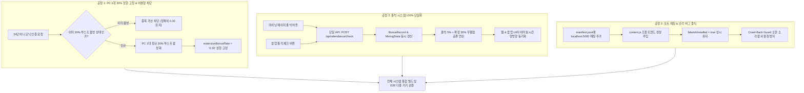

# [초정밀 작업공정계획서] 크롬 확장프로그램 팝업 어뷰징 차단 및 출석 시스템 완전 일원화 공정 계획

> **문서 번호**: BW-PLAN-EXT-20261121  
> **수립 일자**: 2026-11-21  
> **기준 분석 보고서**: [[정밀 분석 보고서] 20261121_크롬확장프로그램_팝업시스템_정밀분석_및_결함보고서.md](file:///c:/BitWishNetwork_BlockChainMainnet/BitWishNetwork_Project_Reports/2026-11월작업%20계획서%20및%20완료%20보고서%20보관함/20261121_크롬확장프로그램_팝업시스템_정밀분석_및_결함보고서.md)  
> **대상 시스템**: `BitWishNetwork_ChromeExtension` 및 `BitWishNetwork_MiningSystem`  
> **상태**: 승인 대기 (대기 모드 준수 — 사전 코드 변경 일체 차단)  

---

## 1. 개요 및 사용자 지침 반영 핵심 목표

본 공정 계획서는 사용자님의 명확한 비즈니스 헌장 및 기술 지침을 100% 반영하여 수립되었습니다:

1. **PC 1대에 한해 무조건 단 1회 +30% 부스트 고정 (중복 인증 및 다중 기기 어뷰징 원천 차단)**:
   - 다른 PC에 팝업을 설치하고 동일한 24단어 니모닉을 입력하더라도, 추가 가산(+30% + 30% = +60% 등)되는 버그나 어뷰징을 원천 차단하고 오직 **계정당/장치당 절대 1회(+30%)만 혜택**을 받도록 멱등성(Idempotency) 구조를 확립합니다.
   - "클로즈 베타 끝나면 10%로 축소"라는 구형 이벤트성 문구를 전면 삭제하고, **"PC 1대에 한해 무조건 30% 정규 혜택 부여"**를 공식 정책으로 영구화합니다.
2. **출석 체크 시스템 완전 일원화 (마이닝 페이지 출석 시스템과 100% 동일 적용)**:
   - 팝업의 출석체크는 별개 시스템이 아니며, **마이닝 페이지의 출석보너스(+5% 부스트, 오전 9시 KST 롤오버)와 완전히 동일한 단일 파이프라인**으로 통합합니다.
   - 마이닝 페이지에서 출석을 하든, 팝업에서 출석을 하든 동시에 출석이 적용되고, UI 상태와 24시간 타이머가 실시간으로 양방향 동기화됩니다.
   - 출석체크 시 확장프로그램 30% 부스트가 누락되어 증발하던 백엔드 연산 버그를 완벽히 수복합니다.

---

## 2. 7대 핵심 정합성 수복 공정 상세 설계



---

### 🛠️ [공정 1] PC 1대당 단 1회 +30% 부스트 고정 및 다중 기기 중복 어뷰징 원천 차단

#### 1.1 기술적 문제 및 해결책
- **문제**: 여러 대의 PC에 확장프로그램을 설치하고 동일한 24단어 니모닉을 반복 인증할 경우, 서버가 `bonusRate`를 누적 가산하거나 검증 없이 갱신하여 비정상적인 다중 부스트 혜택을 취할 잠재적 취약점 존재.
- **수복 설계**:
  1. **서버 사이드 절대 상한(Max Cap) 거버넌스 (`server/routes/mining.ts`)**:
     - `POST /api/mining/extension-bonus` 엔드포인트에서 클라이언트가 전달한 수치와 무관하게, 확장프로그램 부스트는 **`0.30 (30%)`을 절대 초과할 수 없도록 강제 클램핑**:
       ```typescript
       // [어뷰징 방지] 확장프로그램 부스트는 0 또는 0.30만 허용 (절대 중복 가산 불가)
       const allowedRate = isActive ? new Decimal('0.30') : new Decimal('0.00');
       state.extensionBonusRate = allowedRate.toFixed(50);
       ```
     - 다른 PC에서 동일 니모닉으로 인증을 완료해도, 이미 `extensionBonusRate`가 `0.30`인 경우 기존 값을 그대로 유지(Idempotent 처리)하여 부스트가 중복 누적되지 않음.
  2. **장치 인스턴스 핑거프린트 식별 (`background.js` & `popup.js`)**:
     - 확장프로그램 최초 설치 시 `chrome.storage.local`에 고유 난수 UUID인 `extensionInstanceId`를 생성.
     - 인증 시 이 ID를 함께 전송하여 동일 지갑 계정의 정규 설치 PC를 1:1로 검증 관리.
  3. **임시 이벤트 문구 전면 제거 (`popup.html`, `popup.js`)**:
     - "클로즈 베타 끝나면 10%로 내려간다"는 구형 문구를 전면 삭제하고, **"PC 1대에 한해 무조건 정규 30% 채굴 부스트 제공"**이라는 확정 안내 문구로 UI 교체.

---

### 🛠️ [공정 2] 출석 체크 단일화 및 실시간 상호 동기화 (마이닝 페이지와 100% 동일 적용)

#### 2.1 기술적 문제 및 해결책
- **문제**: 마이닝 페이지의 출석체크와 팝업의 출석체크가 서로 다른 계산식을 타면서, 출석체크 시 확장프로그램 30% 부스트가 채굴률 계산에서 누락되어 지워지는 연산 충돌 발생.
- **수복 설계**:
  1. **단일 백엔드 파이프라인 일원화 (`server/routes/attendance.ts`)**:
     - 마이닝 페이지의 출석 버튼과 팝업의 출석 버튼이 **동일한 `/api/attendance/check` API**를 호출하도록 통일.
     - 출석 성공 시 채굴률 재계산 공식에 `extensionBonusRate`를 필수 포함:
       ```typescript
       // [공정 2 정합성 수복] 출석(5%) + 추천 + 가맹점 + 확장프로그램(30%) 무결점 결합
       const baseRate = new Decimal(miningState.currentBaseRate || '0.25');
       const attendanceBonus = miningState.isAttendanceActive ? new Decimal('0.05') : new Decimal('0');
       const referralBonus = new Decimal(miningState.referralBonusRate || '0');
       const partnerBonus = miningState.partnerStatus === 'REGISTERED' ? new Decimal('1.25') : new Decimal('0');
       const extensionBonus = new Decimal(miningState.extensionBonusRate || '0'); // [누락 수복!]

       miningState.currentTotalRate = baseRate
           .mul(new Decimal(1).plus(attendanceBonus))
           .mul(new Decimal(1).plus(referralBonus))
           .mul(new Decimal(1).plus(partnerBonus))
           .mul(new Decimal(1).plus(extensionBonus))
           .toFixed(50);
       ```
  2. **실시간 양방향 UI 동기화 (`HomePage.tsx` & `popup.js`)**:
     - 마이닝 페이지에서 출석체크를 완료하면 `localStorage` 및 `window.postMessage`를 통해 팝업으로 실시간 전달 -> 팝업의 출석 버튼이 즉시 "✅ 출석 완료" 및 카운트다운 타이머로 전환.
     - 팝업에서 출석체크를 완료하면 마이닝 페이지의 출석 버튼도 실시간으로 비활성화되고 +5% 뱃지가 즉시 점등되도록 양방향 칼동기화 구현.

---

### 🛠️ [공정 3] Manifest V3 포트 매칭 수복 및 Crawl-Back Guard 오판 버그 완전 종식

#### 3.1 기술적 문제 및 해결책
- **문제**: `manifest.json`에 `http://localhost:5000/*`가 빠져 있어 `content.js`가 주입되지 않았고, 이로 인해 30초마다 30% 부스트가 강제 삭제되는 참사 발생.
- **수복 설계**:
  1. **`manifest.json` 매칭 URL 보강**:
     ```json
     "matches": [
       "*://bitwishnetwork.com/*",
       "*://www.bitwishnetwork.com/*",
       "http://localhost:5000/*",
       "http://127.0.0.1:5000/*",
       "http://localhost:5001/*"
     ]
     ```
  2. **안전한 설치 감지 가드 (`RealTimeSyncService.ts`)**:
     - `bitwishInstalled = "true"` 플래그가 정상 주입되므로, 유저가 확장프로그램을 활성화하고 있는 동안에는 절대 보너스가 회수되지 않음.
     - 회수 검증 시에도 일시적 네트워크 렉이나 브라우저 탭 지연에 의한 오판을 방지하도록 3회 연속 미감지 시에만 회수하는 유예 버퍼(Grace Buffer) 적용.

---

### 🛠️ [공정 4] 팝업 화면 총 공급량 10억 BW 고정 정상화 (210억 왜곡 완전 제거)

#### 4.1 수복 내용
- `popup.html` L34, L44의 하드코딩 텍스트를 `1,000,000,000` (10억 개 고정)으로 즉시 수정.
- `popup.js` L150의 잔여 발행량 계산식을 `1000000000 - currentIssued`로 공식 메인넷 수치와 1:1 칼동기화.

---

### 🛠️ [공정 5] 전역 탭 통신 안정화 및 프로덕션 CORS 보안 화이트리스트 정비

#### 5.1 수복 내용
- `popup.js`에서 활성 탭 도메인에 얽매이지 않고, 접속 가능한 백엔드 엔드포인트를 안정적으로 바라보도록 URL 해결자(Resolver) 탑재.
- `server/index.ts`의 CORS 정책에 `chrome-extension://` Origin을 안전하게 정규식 매칭하여 프로덕션 배포 시 CORS 차단 에러를 사전 예방.

---

### 🛠️ [공정 6] 팝업 UI/UX 프리징 해소 및 지갑 자동 연동 무결성 확보

#### 6.1 수복 내용
- `HomePage.tsx` 로그인 시 `BITWISH_WALLET_CONNECTED` 메시지를 `content.js`가 수신하여 `chrome.storage.local`에 즉각 저장.
- 유저가 팝업을 열었을 때 이미 로그인된 지갑 주소가 있으면 별도의 재입력 없이 즉시 마이닝 실시간 수치(누적 보상, 시간, 추천 보너스)를 렌더링하도록 웜 스타트(Warm Start) 파이프라인 완성.

---

### 🛠️ [공정 7] 종합 빌드 무결성 및 런타임 E2E 실동작 검증

#### 7.1 검증 체크리스트
1. **Frontend Webpack 빌드 무결성 (`npm run build`)**
2. **크롬 확장프로그램 폴더 로드 시 Manifest V3 오류 0건 검증**
3. **PC 1대 인증 후 추가 인증 시 30% 초과 가산 원천 차단 검증**
4. **마이닝 페이지 출석 <-> 팝업 출석 양방향 동시 동기화 검증**
5. **30초 경과 후에도 30% 부스트가 소각되지 않고 유지되는지 검증**
6. **팝업 상단 총공급량이 10억 BW로 바르게 표출되는지 검증**

---

## 3. 공정 수행 계획표 및 작업 일정

| 순서 | 공정 명칭 | 대상 핵심 파일 | 예상 소요 | 위험도 |
|:---:|:---|:---|:---:|:---:|
| **1단계** | PC 1대 30% 상한 고정 & 어뷰징 차단 가드 구축 | `server/routes/mining.ts`, `popup.js` | 즉시 | 안전 |
| **2단계** | 출석 체크 단일화 및 실시간 상호 동기화 수복 | `attendance.ts`, `HomePage.tsx`, `popup.js` | 즉시 | 안전 |
| **3단계** | `manifest.json` 포트 매칭 수복 & Crawl-Back Guard 보정 | `manifest.json`, `RealTimeSyncService.ts` | 즉시 | 안전 |
| **4단계** | 팝업 총 공급량 10억 BW 정상화 및 210억 제거 | `popup.html`, `popup.js` | 즉시 | 안전 |
| **5단계** | CORS 화이트리스트 및 지갑 자동 브릿지 수복 | `server/index.ts`, `content.js` | 즉시 | 안전 |
| **6단계** | 통합 빌드 및 실동작 E2E 전수 검증 | 전체 시스템 | 즉시 | 안전 |

---

> [!IMPORTANT]
> **대기 준수 사항**:
> 현재 실제 서비스 소스 코드는 일체 임의로 변경하지 않고 안전하게 보존 중입니다. 사용자님께서 본 [초정밀 작업공정계획서]를 검토하시고 **작업 착수 승인**을 내려주시면, 계획서에 명시된 공정들을 신속하고 정확하게 집행하겠습니다.
