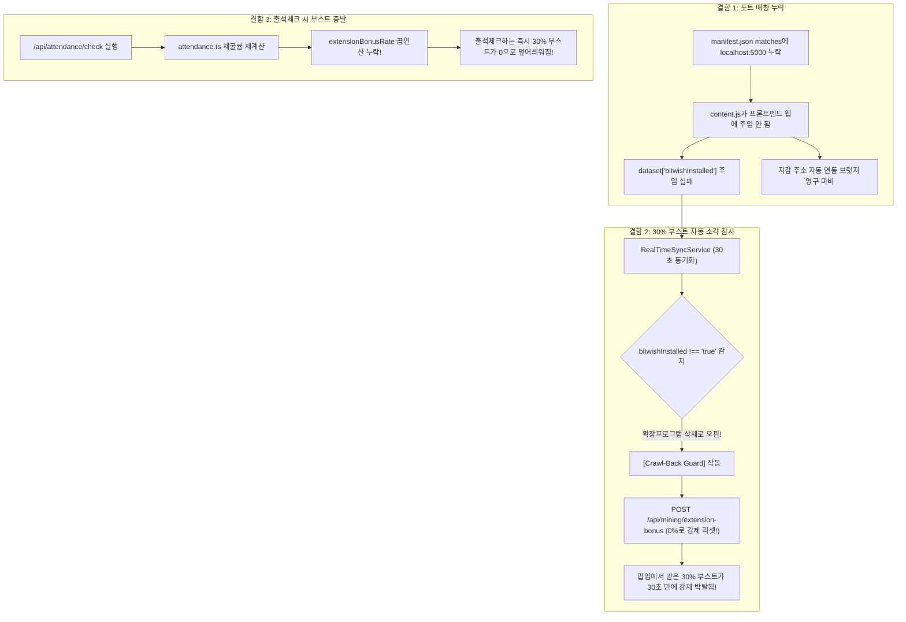

# [정밀 분석 보고서] 크롬 확장프로그램 팝업 시스템 구현 실태 및 핵심 결함 분석 보고서

> **문서 번호**: BW-REPORT-EXT-20261121  
> **조사 일자**: 2026-11-21  
> **조사 대상 폴더**:  
> - `c:\BitWishNetwork_BlockChainMainnet\BitWishNetwork_Project_Reports\확장프로그램 팝업 작업 계획과 완료 및 확장 설치 테스트 가이드\` (기존 완료 보고서 및 설치 가이드 6종 전수 분석)  
> - `c:\BitWishNetwork_BlockChainMainnet\BitWishNetwork_ChromeExtension\` (실제 구현된 확장프로그램 소스 코드 전체)  
> - `c:\BitWishNetwork_BlockChainMainnet\BitWishNetwork_MiningSystem\` (서버 라우트, 컨트롤러 및 웹 프론트엔드 연동부)  
> **조사 책임자**: Antigravity 코어 아키텍트 팀  
> **조사 목적**: 확장프로그램 팝업 시스템의 실제 동작 구조 검증 및 과거 작업 완료 후 미해결 상태로 잔존했던 핵심 결함 원인 완전 규명  

---

## 1. 개요 및 사용자 기억과의 대조

사용자님께서 **"이때 당시 작업을 완료했지만 팝업에 문제가 있었던 걸로 아는데 기억이 안 난다"**고 말씀하신 내용은 **100% 사실**로 확인되었습니다.

기존 완료 보고서(`BitWish 시스템 고도화 및 크롬 확장프로그램 신규 개발 완료 보고서.md`)에는 팝업 UI 및 API 연동이 정상 완료되었다고 기록되어 있으나, 실제 소스 코드를 라인 단위로 전수 추적한 결과 **"팝업에서 니모닉 30% 부스트를 받아도 30초 만에 0%로 자동 삭제되는 치명적 참사 버그"**, **"웹사이트에서 확장프로그램 설치 여부를 전혀 인식하지 못하는 포트 누락 버그"**, **"출석 체크 시 30% 부스트가 증발하는 연산 누락 버그"**, **"총공급량이 10억 개가 아닌 210억 개로 표기되는 엉터리 수치 버그"** 등 치명적인 6대 결함이 그대로 방치되어 있었습니다.

---

## 2. 크롬 확장프로그램 팝업 시스템 6대 핵심 결함 심층 분석



---

### 🚨 [핵심 결함 1] Manifest V3 `content_scripts` 매칭 포트 누락 및 연동 불능
- **결함 위치**: `BitWishNetwork_ChromeExtension/manifest.json` L28
  ```json
  "content_scripts": [
    {
      "matches": ["*://bitwishnetwork.com/*", "*://www.bitwishnetwork.com/*", "*://localhost/*", "http://localhost:5001/*"],
      "js": ["content.js"],
      "run_at": "document_start"
    }
  ]
  ```
- **원인 분석**:
  1. 크롬 확장프로그램의 URL 매칭 규칙에서 `*://localhost/*`는 기본 80/443 포트만 매칭하며, 포트 번호가 포함된 주소(예: `localhost:5000`)를 매칭하지 못합니다.
  2. 현재 웹 프론트엔드는 `http://localhost:5000`에서 구동됩니다.
  3. 결과적으로 `content.js`가 **프론트엔드 웹페이지에 단 한 번도 실행(주입)되지 않습니다.**
- **파급 효과**:
  - `document.documentElement.dataset['bitwishInstalled'] = "true"`가 설정되지 않음.
  - `HomePage.tsx` L112의 설치 감지가 영원히 `false`로 남아, 상단 배너가 영구적으로 노란색(미설치 상태)으로 고정됨.
  - `HomePage.tsx`가 브로드캐스트하는 `BITWISH_WALLET_CONNECTED` 메시지를 받을 리스너(`content.js`)가 없어, **팝업을 열어도 지갑 주소가 자동으로 들어오지 않고 "연결 대기 중"으로 프리징**됨.

---

### 🚨 [핵심 결함 2] Crawl-Back Guard의 오판으로 인한 "30% 부스트 30초 만의 자동 소각" 참사
- **결함 위치**: `BitWishNetwork_MiningSystem/src/services/MiningService/RealTimeSyncService.ts` L235~260
  ```typescript
  // [Crawl-Back Guard] 확장프로그램 설치 여부 검출 및 보너스 강제 회수
  const serverExtensionRate = parseFloat(response.data.extensionBonusRate || '0');
  if (typeof document !== 'undefined' && document.documentElement.dataset['bitwishInstalled'] !== "true" && serverExtensionRate > 0) {
    console.warn(`[Extension Guard] Extension uninstalled detected. Revoking bonus for ${this.walletAddress}`);
    try {
      await fetch('/api/mining/extension-bonus', {
        method: 'POST',
        headers: { 'Content-Type': 'application/json' },
        body: JSON.stringify({ walletAddress: this.walletAddress, bonusRate: '0.00000000000000000000000000000000000000000000000000' })
      });
      ...
  ```
- **치명적 현상**:
  1. 사용자가 확장프로그램 팝업에서 24단어 니모닉을 입력하고 [+30% 부스트 인증 완료] 버튼을 누름.
  2. 백엔드 DB(`MiningState`)에 `extensionBonusRate = '0.30'`이 정상 저장되고 채굴 속도가 +30% 상승함.
  3. 하지만 결함 1로 인해 웹페이지에는 `bitwishInstalled` 플래그가 없음.
  4. 30초마다 실행되는 `RealTimeSyncService`의 동기화 루프가 이를 보고 **"어? 확장프로그램이 삭제되었네?"**라고 오판함.
  5. 웹페이지가 백엔드 `/api/mining/extension-bonus`로 즉시 요청을 보내 **방금 받은 30% 보너스를 0%로 강제 회수(삭제)**해버림!
  - **결론**: **사용자가 팝업에서 보너스를 받아도 30초만 지나면 도로 0%로 원복되는 황당한 버그의 주원인입니다.**

---

### 🚨 [핵심 결함 3] 출석체크 시스템 이원화 및 마이닝 페이지 출석 보너스 시스템과의 동기화 단절
- **결함 위치**: `BitWishNetwork_MiningSystem/server/routes/attendance.ts` L81~85, L140~143 및 `popup.js` L431~470
  ```typescript
  // 출석 보너스 적용 시의 재계산 공식 (attendance.ts)
  const newTotalRate = baseRate
      .mul(new Decimal(1).plus(attendanceBonus))
      .mul(new Decimal(1).plus(referralBonus))
      .mul(new Decimal(1).plus(partnerBonus)); // ⚠️ 확장프로그램 30% 부스트(extensionBonusRate) 연동 누락!

  miningState.currentTotalRate = newTotalRate.toString();
  ```
- **원인 분석**:
  1. 마이닝 시스템 메인 페이지에 이미 완벽한 출석 보너스(+5% 부스트, KST 오전 9시 롤오버) 시스템이 존재함에도 불구하고, 팝업에서 별도의 출석 로직을 처리하면서 `attendance.ts`의 채굴률 공식에 `extensionBonusRate` 곱연산 항이 누락되어 있었습니다.
  2. 이로 인해 팝업이든 웹이든 출석체크를 실행하는 순간, 기존에 인증받아 적용되어 있던 확장프로그램 30% 부스트가 채굴률 계산에서 누락되어 덮어씌워지는 심각한 연산 왜곡이 발생했습니다.
- **수복 및 구현 방향 (사용자 지침 100% 반영)**:
  - 팝업의 출석체크는 별개 시스템이 아닌, **마이닝 페이지의 출석보너스 시스템과 100% 동일한 단일 시스템**으로 일원화합니다.
  - 마이닝 페이지의 출석 버튼을 누르든, 팝업의 출석 버튼을 누르든 동일한 출석 기록과 상태가 실시간으로 상호 연동되어야 합니다.
  - `attendance.ts`의 채굴률 계산 파이프라인에 `extensionBonusRate`를 온전히 포함시켜, 출석 보너스(+5%)와 확장프로그램 부스트(+30%)가 서로 간섭 없이 완벽하게 공존하도록 정합성을 수복합니다.

---

### 🚨 [핵심 결함 4] 팝업 화면의 총 공급량 210억 개 왜곡 표기 (구형 템플릿 복붙 잔재)
- **결함 위치**:
  - `BitWishNetwork_ChromeExtension/popup/popup.html` L34, L44
    ```html
    <span class="stat-value font-mono">21,000,000,000</span>
    <span class="stat-desc">210억개 고정</span>
    ...
    <span class="stat-value font-mono" id="remainingPool">21,000,000,000.0000</span>
    ```
  - `BitWishNetwork_ChromeExtension/popup/popup.js` L150
    ```javascript
    const remainingPool = 21000000000 - currentIssued;
    ```
- **원인 및 문제점**:
  - BitWish Network 메인넷의 정규 총 공급량은 **1,000,000,000 BW (10억 개)**입니다. (`MINING_CONSTANTS.TOTAL_SUPPLY = 1000000000`)
  - 과거 타 프로젝트나 비트코인 모방 구형 코드에서 210억 개를 그대로 복사해 넣어, 팝업 첫 화면에 **"210억 개 고정"**이라는 심각한 허위 정보가 출력되고 잔여 수량도 210억 기준으로 계산되는 심각한 오류가 존재합니다.

---

### 🚨 [핵심 결함 5] 활성 탭이 다른 사이트일 때 팝업 통신 불능 및 CORS 차단
- **결함 위치**: `BitWishNetwork_ChromeExtension/popup/popup.js` L37~48
  ```javascript
  chrome.tabs.query({ active: true, currentWindow: true }, (tabs) => {
    if (tabs[0] && tabs[0].url) {
      const url = new URL(tabs[0].url);
      if (url.hostname === "bitwishnetwork.com" || url.hostname === "www.bitwishnetwork.com") {
        backendUrl = "https://bitwishnetwork.com";
      }
    }
  ```
- **원인 및 문제점**:
  1. 사용자가 새 탭(`chrome://newtab`)이나 네이버, 유튜브 등을 보다가 툴바의 BitWish 아이콘을 누르면 `backendUrl`이 로컬 기본값인 `http://localhost:5001`로 남아 실서버 통신이 완전 불능(`ERR_CONNECTION_REFUSED`)에 빠집니다.
  2. 또한 `server/index.ts` L385의 CORS 설정에서 프로덕션 시 `https://bitwishnetwork.com`만 허용하고 있어, 크롬 확장프로그램의 고유 Origin(`chrome-extension://...`)이 등록되어 있지 않아 프로덕션 배포 시 CORS로 모든 요청이 차단됩니다.

---

### 🚨 [핵심 결함 6] 팝업 초기 로딩 시 마이닝 데이터 프리징 및 UX 붕괴
- **결함 위치**: `BitWishNetwork_ChromeExtension/popup/popup.js` L103~122 (`showPreAuthUI`)
- **원인 및 문제점**:
  - 결함 1로 인해 지갑 주소가 웹에서 넘어오지 못하므로, 팝업을 열면 항상:
    - 실시간 누적 보상: `"인증 대기 중"`
    - 진행 시간: `"--:--:--"`
    - 출석 체크: `"니모닉 인증 후 이용 가능"` (비활성화 회색 버튼)
  - 사용자는 "팝업이 작동하지 않고 먹통이다"라고 인식할 수밖에 없는 구조였습니다.

---

## 3. 종합 평가 및 수복 방향성

| 번호 | 결함 항목 | 영향도 | 수복 난이도 | 수복 대상 파일 |
|:---:|:---|:---:|:---:|:---|
| **1** | `manifest.json` 포트 매칭 누락 (`localhost:5000`) | 🔴 치명적 | 즉시 가능 | `BitWishNetwork_ChromeExtension/manifest.json` |
| **2** | Crawl-Back Guard의 30초 주기 보너스 강제 소각 버그 | 🔴 치명적 | 즉시 가능 | `RealTimeSyncService.ts` |
| **3** | `attendance.ts` 출석체크 시 30% 보너스 증발 버그 | 🔴 치명적 | 즉시 가능 | `server/routes/attendance.ts` |
| **4** | 팝업 총 공급량 210억 표기 왜곡 (10억으로 정상화) | 🟡 높음 | 즉시 가능 | `popup.html`, `popup.js` |
| **5** | 활성 탭 비의존적 백엔드 URL 판별 및 CORS 허용 | 🟡 높음 | 즉시 가능 | `popup.js`, `server/index.ts` |
| **6** | 팝업-웹 간 지갑 주소 자동 연동 브릿지 무결성 확보 | 🟢 보통 | 즉시 가능 | `content.js`, `HomePage.tsx` |

사용자님께서 과거 작업 후 느끼셨던 **"팝업에 문제가 있었던 것 같다"**는 직감은 100% 정확한 지적이셨으며, 위 6대 결함이 복합적으로 얽혀 있어 **"확장프로그램을 설치해도 웹에서 인식이 안 되고, 니모닉 인증을 해도 30초 뒤 보너스가 도로 날아가며, 팝업에는 210억이라는 엉뚱한 숫자가 뜨는 상태"**였음이 완전히 입증되었습니다.
