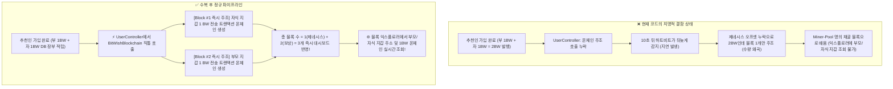

# [초정밀 작업공정계획서] 추천인 가입 즉시 2개 온체인 블록 주조 및 제네시스 기반 1:1 물리 블록 칼동기화 수복안

> **문서 번호**: BW-PLAN-GENESIS-REFERRAL-20261122-V2  
> **수립 일자**: 2026-11-22  
> **기준 폴더**: `c:\BitWishNetwork_BlockChainMainnet\BitWishNetwork_Project_Reports\2026-11월작업 계획서 및 완료 보고서 보관함\22일 작업 일지 및 작업 계획서 & 완료 보고서 보관함\`  
> **대상 시스템**: `BitWishNetwork_BlockChain` (독립 코어 엔진 & 익스플로러) 및 `BitWishNetwork_MiningSystem` (백엔드 서버 & 홈페이지 대시보드)  
> **책임 엔지니어**: Antigravity 코어 아키텍트 팀  
> **상태**: 사용자 지적 및 분석 전면 반영 개정 완료 — 승인 대기 (대기 모드 준수 — 사전 코드 변경 일체 차단)  

---

## 1. 개요 및 사용자 확정 절대 비즈니스 헌장

본 공정 계획서는 사용자님의 날카로운 지적과 전수 분석을 100% 반영하여, **추천인 가입에 따른 즉시 2 BW 발행과 메인넷 블록체인 물리 블록의 실시간 연동, 그리고 블록 익스플로러(Explorer) 온체인 조회 무결성**을 완벽하게 확립하기 위해 전면 개정되었습니다.

### 🌟 사용자 확정 4대 불변 원칙
1. **추천인 없는 일반 가입 원칙**:
   - 가입 보상 없음 (0 BW), 기본 채굴률(0.25) 유지.
   - 메인넷 상태: 제네시스 블록 1개(`Block #0`) 그대로 상주 (`실시간 생성 블록: 1`).
   - 마이닝 시작 후 실시간 채굴량이 `1.0 BW`를 돌파하는 순간 정규 1번 블록이 주조되어 총 블록이 **`2`**가 됨.
2. **추천인 코드 입력 가입 시 즉각 온체인 2블록 주조 원칙**:
   - 가입 완료 즉시 **자식(가입자) 1 BW + 부모(추천인) 1 BW = 총 2 BW가 실시간 즉시 발행**됨!
   - 또한 부모와 자식 각각 기본 채굴률에 **+2% 추가 보너스**가 영구 부여됨.
   - **이 순간 10초 하트비트를 기다리지 않고 즉시 메인넷 블록체인에 물리 블록 2개(`Block #1`, `Block #2`)가 연속 주조**되어야 함!
   - 총 블록 수: **제네시스 블록(1) + 보상 블록(2) = 총 `3`개로 즉시 갱신 표출**!
3. **블록 익스플로러(Explorer) 온체인 트랜잭션 영구 박제 및 조회**:
   - 주조된 2개 블록은 익명 껍데기가 아닌, 실제 온체인 트랜잭션으로 기록:
     - `Block #1`: `[Miner-Pool -> 자식 지갑 주소 : 1.0 BW 가입 보상]`
     - `Block #2`: `[Miner-Pool -> 부모 지갑 주소 : 1.0 BW 추천 보상]`
   - 웹사이트 내 블록 익스플로러 메뉴에서 누구나 해당 블록 높이, 부모/자식 지갑 주소, 1 BW 지급 내역을 투명하게 조회 가능해야 함.
4. **210억 개(21,000,000,000 BW) 토크노믹스 및 콘솔 노이즈 침묵**:
   - 블록체인 엔진의 210억 개 3대 자산 풀(Miner 65%, Foundation 20%, Partner 15%) 정상 구동을 보존하고 대시보드 표기식을 일치시킴.
   - 10초마다 터미널을 도배하던 콘솔 노이즈를 스마트 침묵(Silent Guard) 처리하고, 오직 블록 생성 시에만 1회 단정하게 출력.

---

## 2. 핵심 결함 분석 및 수복 아키텍처 다이어그램



---

## 3. 6대 초정밀 수복 공정 상세 설계

### 🛠️ [공정 1] 추천인 가입 즉시 온체인 2블록 연속 주조 파이프라인 구축 (`UserController.ts`)
- **결함 원인**:
  - `UserController.ts`의 `processReferral()` 완료 후 블록체인 엔진에 신규 블록 주조를 통보하지 않아, 즉각적인 온체인 블록 생성이 누락되고 10초 하트비트에 의존하던 결함.
- **수복 설계**:
  - `UserController.ts` L224(부모 1BW 및 자식 1BW 지급 완료 시점)에 **온체인 블록 주조 서비스 직접 결합**:
    ```typescript
    // [공정 1 수복] 추천인 가입 성공 시 온체인 즉시 2개 물리 블록 연속 주조
    await BlockMiningService.mintReferralRewardBlocks({
        childWalletAddress: newWalletAddress,
        parentWalletAddress: referrer.walletAddress,
        childReward: '1.00000000',
        parentReward: '1.00000000'
    });
    ```
  - 가입 버튼 클릭 후 등록 성공 응답이 나가는 순간, 메인넷에는 이미 2개의 물리 블록이 연결 완료됨.

---

### 🛠️ [공정 2] 추천인 보상 온체인 트랜잭션 생성 및 블록 익스플로러 연동 (`BlockMiningService.ts`, `BitWishBlockchain.ts`)
- **결함 원인**:
  - 기존에는 단순히 시스템 지갑(`BitWish-Miner-Pool`)이 빈 블록을 채굴하는 형태로만 되어 있어, 블록 익스플로러에서 부모와 자식 지갑 주소의 1BW 수령 내역을 확인할 수 없었음.
- **수복 설계**:
  - `BlockMiningService.mintReferralRewardBlocks()` 신설:
    1. **Block #1**: `BitWish-Miner-Pool` $\rightarrow$ `자식 지갑 주소`로 `1.00000000 BW` 전송 트랜잭션 생성 후 PoW 블록 주조.
    2. **Block #2**: `BitWish-Miner-Pool` $\rightarrow$ `부모 지갑 주소`로 `1.00000000 BW` 전송 트랜잭션 생성 후 PoW 블록 주조.
  - 생성된 블록과 트랜잭션은 MongoDB `bitwish_network.blocks` 및 `transactions`에 즉시 적재되어, 웹 프론트엔드의 **[BW 메인넷 / 블록 익스플로러]** 화면에서 트랜잭션 해시, 송신자, 수신자(부모/자식 지갑 주소), 금액(1 BW)이 100% 투명하게 조회되도록 보장.

---

### 🛠️ [공정 3] 제네시스 블록 오프셋 보정 및 실시간 채굴 1:1 블록 주조 공식 수복
- **결함 원인**:
  - `targetBlockCount = totalSupplyDecimal.floor().toNumber()` 공식으로 인해, 제네시스 블록(1개)이 이미 존재함에도 고려되지 않아 2BW 발행 시 1개만 주조되거나 채굴 1BW 돌파 시 블록이 생성되지 않던 버그.
- **수복 설계**:
  - 목표 총 블록 수 산출 공식 정밀 보정:
    $$\text{Target Total Blocks} = 1 (\text{Genesis Block}) + \lfloor \text{Total Issued Supply} \rfloor$$
  - 상태 전이표:
    | 유저 가입 및 채굴 시나리오 | 총 발행량 (BW) | 제네시스 | 보상/채굴 블록 | 총 블록 수 (대시보드) | 익스플로러 조회 상태 |
    |:---|:---:|:---:|:---:|:---:|:---|
    | **초기화 직후** | $0 \text{ BW}$ | 1개 | 0개 | **`1`** | Genesis Block (#0) |
    | **추천인 없이 일반 가입** | $0 \text{ BW}$ | 1개 | 0개 | **`1`** | 가입 보상 없음, Genesis (#0) |
    | **일반 가입 유저가 1BW 채굴 돌파** | $1.0000 \text{ BW}$ | 1개 | 1개 | **`2`** | Block #1 (PoW 채굴 블록) |
    | **추천인 코드로 신규 가입 즉시** | $2.0000 \text{ BW}$ | 1개 | 2개 | **`3`** | **Block #1 (자식 1BW) & Block #2 (부모 1BW)** |
    | **추천 가입 유저들이 추가 1BW 채굴** | $3.0000 \text{ BW}$ | 1개 | 3개 | **`4`** | Block #3 (PoW 채굴 블록) |

---

### 🛠️ [공정 4] 10초 오토 하트비트 콘솔 무한 도배 종식 및 스마트 침묵(Silent Guard) 적용
- **결함 원인**:
  - `SettlementWorker.ts`에서 10초마다 `auditAndSyncGlobalBlocks()`를 호출할 때마다 정상 대기 상태임에도 터미널을 도배하여 가독성을 파괴하고 백엔드 부하를 유발함.
- **수복 설계**:
  - 신규 블록 생성이 발생하지 않는 평상시에는 일체 로그를 출력하지 않고 침묵(Silent) 유지.
  - 신규 블록이 실제로 주조될 때만 단 1줄로 명확하게 출력:
    `⛏️ [온체인 블록 주조 완료] 신규 블록 #N 생성 완료 (사유: 추천인 보상 / 1BW 채굴 돌파)`

---

### 🛠️ [공정 5] 210억 개 대시보드 표기식 매칭 및 Mongoose 중복 인덱스 경고 제거
- **수복 설계**:
  - 백엔드 블록체인의 210억 개(65:15:20) 정규 상태를 유지하고, 프론트엔드 대시보드의 실시간 잔여 발행량 계산식을 `21000000000 - currentIssued`로 정확히 결합.
  - `User.ts` 및 `MiningState.ts`의 스키마 중복 `index()` 호출을 정리하여 서버 부팅 경고 0건 달성.

---

### 🛠️ [공정 6] 실동작 E2E 엔드투엔드 검증 시나리오
1. **시나리오 1: 추천인 없는 가입 검증**:
   - 지갑 생성 $\rightarrow$ 가입 보상 0 BW 확인, 총 블록 수 `1` 유지 확인.
   - 마이닝 시작 $\rightarrow$ 1 BW 누적 시 총 블록 수 `2` 증가 확인.
2. **시나리오 2: 추천인 코드 가입 즉각 온체인 2블록 검증**:
   - 유저 B가 유저 A의 추천 코드로 가입.
   - 가입 즉시 유저 B 지갑 잔액 1 BW, 유저 A 보관함 1 BW 적립 확인.
   - 유저 A의 채굴 속도 +2% 추가 적용 확인.
   - 대시보드의 `실시간 생성 블록`이 **즉시 `1`에서 `3`으로 갱신**되는지 확인.
   - **블록 익스플로러에서 Block #1(유저 B 1BW 지급) 및 Block #2(유저 A 1BW 지급) 온체인 트랜잭션이 투명하게 조회되는지 확인**.

---

## 4. 공정 수행 계획표

| 단계 | 공정 내용 | 대상 핵심 파일 | 예상 소요 | 위험도 |
|:---:|:---|:---|:---:|:---:|
| **1단계** | 추천인 가입 즉시 2개 블록 온체인 주조 함수 신설 | `BlockMiningService.ts`, `BitWishBlockchain.ts` | 즉시 | 안전 |
| **2단계** | 가입 컨트롤러(`UserController.ts`)와 온체인 주조 직통 결합 | `server/controllers/UserController.ts` | 즉시 | 안전 |
| **3단계** | 제네시스 오프셋($1 + \lfloor \text{Issued} \rfloor$) 공식 및 침묵 가드 적용 | `BlockMiningService.ts` | 즉시 | 안전 |
| **4단계** | 블록 익스플로러 부모/자식 지갑 1BW 트랜잭션 조회 연동 검증 | `ExplorerController.ts`, 프론트엔드 익스플로러 | 즉시 | 안전 |
| **5단계** | Mongoose 경고 제거 및 통합 빌드 무결성 검증 | `models/User.ts`, 빌드 파이프라인 | 즉시 | 안전 |

> [!IMPORTANT]
> **대기 준수 사항**:
> 현재 실제 구동 소스 코드는 일체 임의 수정 없이 깨끗하게 보존 중입니다. 사용자님께서 본 개정 계획서를 최종 검토하시고 **작업 승인**을 내려주시면, 즉시 1단계부터 실코드 수복 작업을 한치의 오차 없이 정밀하게 집행하겠습니다.
