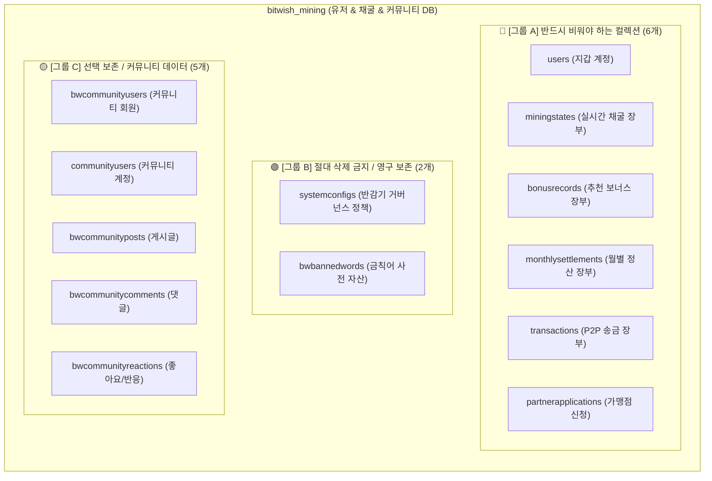

# 📘 [BitWish Network] MongoDB 초기화 및 리셋 표준 지침서 (최신 개정판)

> **⚠️ 필독 경고**: 
> 과거 지침서와 달리, **`bitwish_mining` 데이터베이스를 통째로 Drop(삭제)하시면 절대로 안 됩니다!**  
> `bitwish_mining` 내부에는 대표님께서 설정하신 **반감기 거버넌스 정책(`systemconfigs`)**과 **금칙어 사전(`bwbannedwords`)**이 들어있으므로, 반드시 아래 분류표에 따라 지정된 컬렉션만 정확하게 비워주셔야 합니다.

---

## 1. 🗄️ Compass 화면 기준 전체 컬렉션 3대 분류표 (`bitwish_mining`)

현재 MongoDB Compass의 `bitwish_mining`에 존재하는 **총 13개 컬렉션**의 명확한 처리 기준입니다.



---

### 🔴 [그룹 A] 채굴/지갑 리셋 시 반드시 삭제(비우기)해야 하는 컬렉션 (총 6개)
> **조작 방법**: 해당 컬렉션 클릭 ➡️ 상단 **`Drop Collection`** 클릭 (또는 내부 Documents 전체 비우기)

| 컬렉션 명칭 | 처리 구분 | 필수 작업 내용 및 삭제 사유 |
| :--- | :---: | :--- |
| **`users`** | 🗑️ **필수 삭제** | 생성된 테스트 지갑 주소, 니모닉 해시, 추천인 코드 목록 완전 초기화. |
| **`miningstates`** | 🗑️ **필수 삭제** | 유저별 실시간 누적 채굴량, 채굴 시작 시각, 현재 채굴률 장부 완전 초기화. |
| **`bonusrecords`** | 🗑️ **필수 삭제** | 추천인 보너스 2% 누적 장부 및 1 BW 추천 가입 보상 내역 완전 초기화. |
| **`monthlysettlements`** | 🗑️ **필수 삭제** | 과거 월말 확정 정산 및 타임락 잠금 장부 기록 완전 초기화. |
| **`transactions`** | 🗑️ **필수 삭제** | 지갑 간 P2P 내부 송금 트랜잭션 기록 완전 초기화. |
| **`partnerapplications`** | 🗑️ **필수 삭제** | 테스트용 가맹점 등록 신청 건 완전 초기화. |

---

### 🟢 [그룹 B] 절대 삭제하면 안 되는 핵심 시스템 자산 (총 2개 - 영구 보존)
> **조작 방법**: 🛡️ **마우스로 건드리지 마십시오! (절대 Drop 금지)**

| 컬렉션 명칭 | 처리 구분 | 영구 보존 및 보호 사유 |
| :--- | :---: | :--- |
| **`systemconfigs`** | 🛡️ **절대 보존** | **반감기 거버넌스 정책(`halving_policy`) 영구 보관함.**<br>대표님께서 관리자 페이지에서 설정하신 반감기 시작일(예: 2026-09-01, 2026-10-01), ON/OFF 스위치, 감소율이 저장되어 있습니다.<br>※ 만약 이 컬렉션을 삭제하면 대표님의 반감기 설정이 모두 날아가고 백서 초기값(2028년, OFF)으로 강제 리셋됩니다! |
| **`bwbannedwords`** | 🛡️ **절대 보존** | **커뮤니티 불법/비속어 차단 금칙어 사전.**<br>시스템 보안 자산이므로 삭제 시 욕설 필터링 엔진이 마비됩니다. |

---

### 🟡 [그룹 C] 선택 보존 컬렉션 (커뮤니티 전용 데이터 - 총 5개)
> **판단 기준**: 커뮤니티에 작성한 테스트 글/댓글까지 전부 깨끗이 지우고 싶다면 삭제, 커뮤니티 내용은 그대로 두고 싶다면 보존.

| 컬렉션 명칭 | 처리 구분 | 설명 |
| :--- | :---: | :--- |
| **`bwcommunityusers`** | 🟡 **선택 보존** | 커뮤니티 프로필 회원 정보 (삭제해도 서버 기동 시 관리자 계정은 자동 재생성됨) |
| **`communityusers`** | 🟡 **선택 보존** | 커뮤니티 보조 계정 정보 |
| **`bwcommunityposts`** | 🟡 **선택 보존** | 커뮤니티 게시판 작성 글 목록 |
| **`bwcommunitycomments`** | 🟡 **선택 보존** | 커뮤니티 게시글 댓글 목록 |
| **`bwcommunityreactions`** | 🟡 **선택 보존** | 커뮤니티 게시글 좋아요/반응 데이터 |

---

## 2. 🌐 `bitwish_network` (블록체인 메인넷 코어 DB) 리셋 기준

> **💡 가장 간편한 방법**: `bitwish_network` DB는 컬렉션을 일일이 지울 필요 없이 **데이터베이스 이름(`bitwish_network`) 우측의 휴지통(Drop Database) 아이콘을 눌러 통째로 삭제**하시면 됩니다.

서버가 재기동될 때 아래 **4개 컬렉션이 210억 개 제네시스 블록(#0) 상태로 1초 만에 자동 재생성**됩니다:

| 컬렉션 명칭 | 처리 구분 | 서버 재기동 시 자동 재생성 내용 |
| :--- | :---: | :--- |
| **`accounts`** | 🗑️ **통째 Drop** | 3대 코어 풀 계정(총 210억 BW: Miner 65%, Partner 15%, Foundation 20%) 자동 재생성 |
| **`blocks`** | 🗑️ **통째 Drop** | 제네시스 블록(#0, 블록 수 1개)으로 깨끗하게 자동 생성 |
| **`blocktransactions`**| 🗑️ **통째 Drop** | 제네시스 발행 트랜잭션으로 자동 초기화 |
| **`network_stats`** | 🗑️ **통째 Drop** | 블록 높이 0, 총 블록 1개 통계로 자동 재구성 |

---

## 3. ⚡ [초간단] 마이닝 완전 리셋 표준 4단계 실전 절차

대표님께서 테스트를 처음부터 완전히 깨끗하게 다시 시작하실 때 수행하는 표준 순서입니다:

### 1단계: 백엔드 서버 중지
* 백엔드가 실행 중인 검은색 터미널 창에서 **`Ctrl + C`**를 눌러 서버를 멈춥니다.

### 2단계: MongoDB Compass에서 2가지만 작업
1. **`bitwish_network` DB 삭제**:
   * 왼쪽 트리에서 `bitwish_network` 우측 **휴지통(Drop Database)** 클릭 ➡️ `bitwish_network` 입력 후 Drop.
2. **`bitwish_mining` DB의 [그룹 A] 6개 컬렉션만 Drop**:
   * 아래 6개 컬렉션의 우측 휴지통(Drop Collection)을 눌러 삭제합니다:
     1. `users`
     2. `miningstates`
     3. `bonusrecords`
     4. `monthlysettlements`
     5. `transactions`
     6. `partnerapplications`
   * ⚠️ **주의**: `systemconfigs`(반감기 정책)와 `bwbannedwords`는 절대 지우지 마세요!

### 3단계: 브라우저 캐시 및 로컬스토리지 정리
* 크롬 브라우저에서 **`F12`** 누름 ➡️ **`Application(애플리케이션)`** 탭 ➡️ 좌측 **`Storage`** 또는 **`Local Storage`** ➡️ **`Clear site data(사이트 데이터 삭제)`** 클릭.
* *(이전 테스트 지갑의 브라우저 캐시와 로그인 세션 잔재를 완전히 없애줍니다.)*

### 4단계: 백엔드 서버 재실행
* 터미널에서 **`npm run backend`** 실행!
* 터미널에 아래와 같이 **제네시스 블록 생성 로그와 대표님의 최신 반감기 브리핑 박스가 함께 출력**되면 100% 완벽 복원 성공입니다:

```text
Connected to MongoDB Hybrid Storage
Server is running on port 5001
Server restarted at ...

[BitWish Governance] 🚀 선형 반감기 실시간 발동 종합 브리핑
• 엔진 가동 상태   : 🚀 ON (선형 반감기 실시간 공식 발동 중)
• 반감기 시작 일시 : 2026년 09월 01일 AM 12:00:00 (KST 한국 표준시)
• 시작일 경과 일수 : 시작일 기준 D+85일 경과 (현재 2차 반감기 구간)
• 현재 적용 감소율 : -10.0% 선형 감산 적용 중
• 현재 기본 채굴률 : 0.22500000 BW/h (일일 최대 5.400000 BW / 24h)

🌱 새로운 BitWish 블록체인 초기화...
👤 계정 생성: BitWish-Miner-Pool (잔액: 13650000000 BW)
👤 계정 생성: BitWish-Partner-Pool (잔액: 3150000000 BW)
🏛️ 계정 생성: BitWish-Foundation (잔액: 4200000000 BW)
🔗 제네시스 블록: 1개 생성 (블록 높이: 0)
📊 총 블록 개수: 1개
🪙 총 발행량: 21000000000 BW
```

---

이 지침서에 따라 리셋하시면, **대표님께서 설정해 두신 반감기 정책(`systemconfigs`)은 안전하게 살아있으면서도, 지갑과 채굴 데이터만 완전한 0번 제네시스 상태로 깨끗하게 초기화**되어 다음 테스트를 완벽하게 진행하실 수 있습니다!
